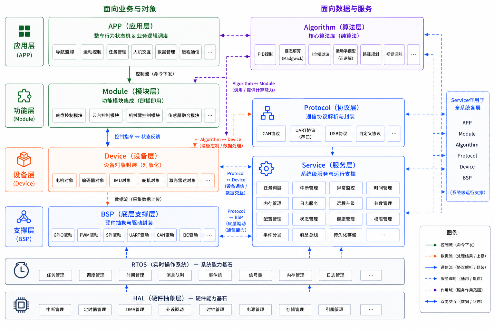
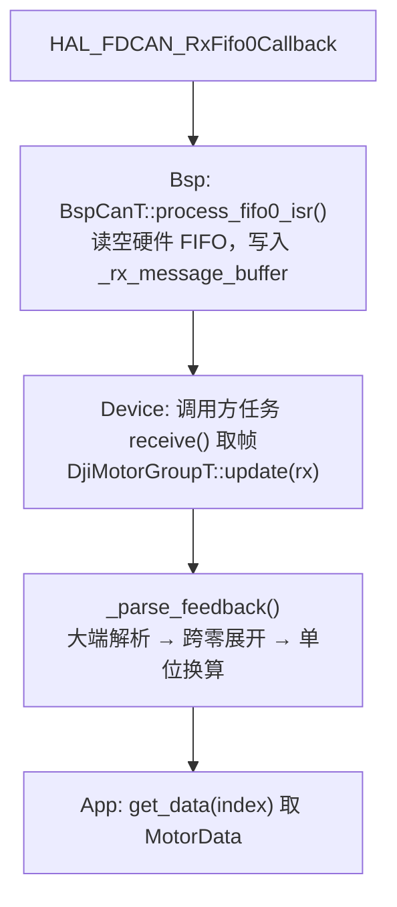
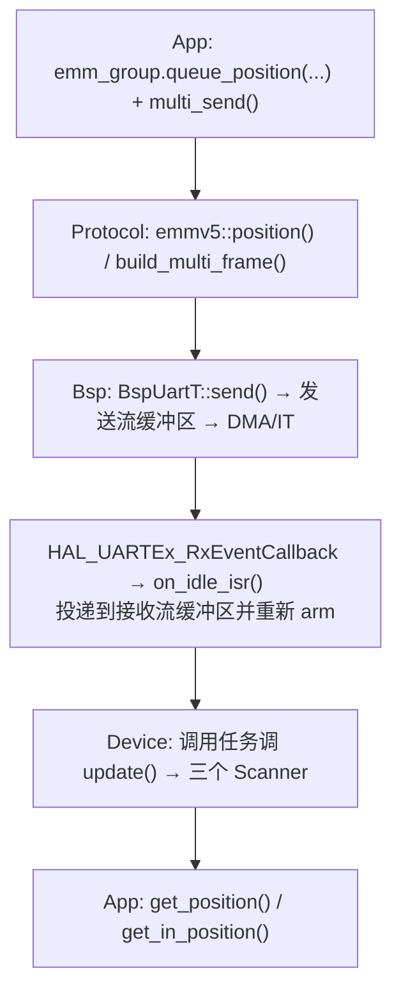

# 分层架构

## 依赖方向

```txt
App（应用层，api_xxx 转接）
 └─ Module（模块层，多设备组合）
     └─ Device（设备层，单设备驱动）
         └─ Protocol（协议层，纯编码 / 解析）
             └─ Bsp（板载支持包，不考虑上层硬件细节）
```

- 依赖单向：上层可以使用下层，**禁止反向依赖**。判断方法很简单——下层文件里不应出现上层的头文件。
- `Service` / `Algorithm` 不属于这条主链，以工具库、服务的形式贯穿各层。
- `Protocol` 只做字节级编解码，不发送、不读缓冲；设备层把帧交给它、把收到的字节喂给它。
- 跨层通信只使用下一层暴露的全局实例，不直接操作 HAL。



## 各层职责

| 层 | 职责 | 典型内容 |
| --- | --- | --- |
| App | 任务创建与业务编排；C/C++ 转接 | `api_main`（`all_init()` / `StartDefaultTask`）、`task/`、`test/` |
| Module | 由多个设备组合而成的模块 | `corexy`（两台 EmmV5 的平面机构） |
| Device | 单设备 / 单总线设备组 | `dji_motor_group`、`device_emmv5_group`、`device_r9ds`、`device_servo`、`device_buzzer` |
| Protocol | 协议帧编码与应答解析 | `emmv5_protocol`（EmmV5 帧、扫描器、MMCL） |
| Bsp | 板载支持包：只认识外设，不认识业务 | `bsp_can`、`bsp_uart`、`bsp_pwm`、`bsp_key`、`bsp_gpio`、`bsp_dwt` |
| Service | 跨设备公共设施 | `status`（`Status` + `EventState`）、`service_cfg`、`online_check`、`motor_definition` |
| Algorithm | 与硬件无关的算法 | `pid` |

每层的用法、调用链与新增模块清单见对应目录的 `README.md`：
[Bsp](../../User/Bsp/README.md) / [Protocol](../../User/Protocol/README.md) /
[Device](../../User/Device/README.md) / [Service](../../User/Service/README.md)。

## 全局实例的归属

各层的全局实例集中在同层的 `xxx_cfg.{hpp,cpp}`：实例在 `.cpp` 中定义，`.hpp` 中 `extern`，该层的初始化函数也放在这里。

| 层 | 文件 | 内容 |
| --- | --- | --- |
| Bsp | `bsp_cfg.{hpp,cpp}` | `bsp_dwt`、`bsp_can1/2/3`、`bsp_uart1/2/3/4/7/8/9/10`、`bsp_uart_it5`、9 路 `BspGpio`、6 路 `BspPwm`、`key_user`、`bsp_init()` |
| Service | `service_cfg.{hpp,cpp}` | `sys_state`、`service_init()` |
| Protocol | —（无实例，纯函数 / 值类型） | — |
| Device | `device_cfg.{hpp,cpp}` | `buzzer`、`can3_dji_group`、`r9ds`、`emm_motor1`、`emm_group`、`servo1~4`、`device_init()` |
| Module | `module_cfg.{hpp,cpp}` | `corexy`、`module_init()` |
| App | `api_main.{h,cpp}` | `all_init()` 与 `StartDefaultTask` |

## 一次调用的完整链路

### CAN 电机反馈



- Bsp 只负责「把硬件事件变成一帧数据」，不认识电机、不理解协议。
- Device 负责「这一帧属于哪台、字节代表什么物理量」，不创建接收任务（由调用方任务驱动）。
- App 只使用换算后的物理量。

### 串口命令与应答（EmmV5）



- Protocol 只拼字节、切字节；Bsp 只搬字节；Device 把字节变成物理量与在线状态。
- 调用 `update()` 的那个任务就是该路串口唯一的接收消费者，其他任务只发命令、取结果。

## 统一接口：`update(timeout_ms)`

有**外部数据源**的类统一暴露 `update(timeout_ms)`：0 = 非阻塞（有多少处理多少），
N = 最多阻塞 N ms 等数据到。纯计算 / 纯写寄存器的类不提供 `update()`。

| 层 | 类 | 周期接口 | 带等待参数 | 说明 |
| --- | --- | --- | --- | --- |
| Bsp | `bsp_uart` | — | 收发接口自带 `timeout` | 没有 `update()`：收在 `receive(buf,size,timeout)` 里等 |
| Bsp | `bsp_can` | — | `receive(&rx, timeout)` | 没有 `update()`：帧由设备任务自己取 |
| Bsp | `bsp_key` | `update()` | 否 | 读 GPIO，没有可等的“数据到达” |
| Bsp | `bsp_gpio` | — | — | 纯电平读写 |
| Bsp | `bsp_pwm` | — | — | 纯寄存器写 |
| Bsp | `bsp_dwt` | — | — | 纯读计数器 |
| Device | `device_emmv5_group` | `update(timeout_ms)` | **是** | 等串口字节最多 N ms |
| Device | `device_r9ds` | `update(timeout_ms)` | **是** | 等串口字节最多 N ms |
| Device | `dji_motor_group` | `update(const CanRxMsg &)` | 否 | 帧由调用方传入；要等就在 `bsp_can.receive(..., timeout)` 上等 |
| Device | `device_servo` | `update()` | 否 | 纯轨迹积分，没有数据源 |
| Device | `device_buzzer` | — | — | 纯 PWM 写 |
| Module | `corexy` | `update(timeout_ms)` | **是** | 透传给设备组，先收字节再推进状态机 |

约定：

1. 带等待的 `update()` 只在**第一次**取数据时等，后续把已到的数据排空，不会把 N ms 重复叠加；
2. 同一路总线的 `update()` 只能有一个任务调（接收缓冲区只有一个消费者）；
3. 等待期间调用任务被挂起，不要在中断或高优先级实时循环里用非 0 超时。
