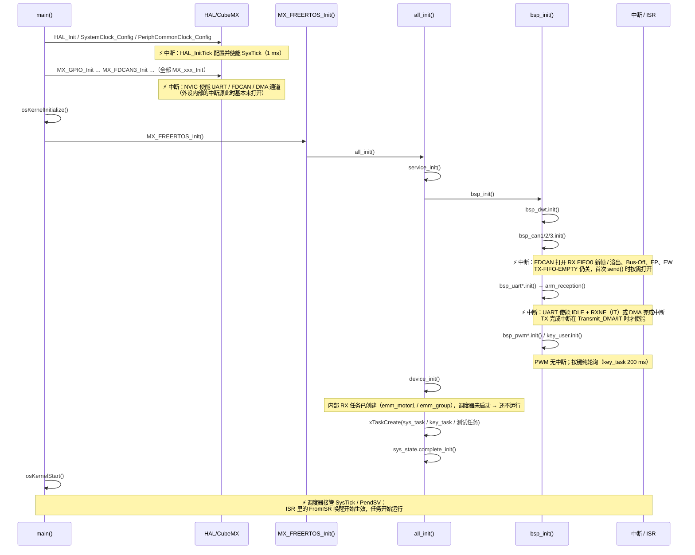
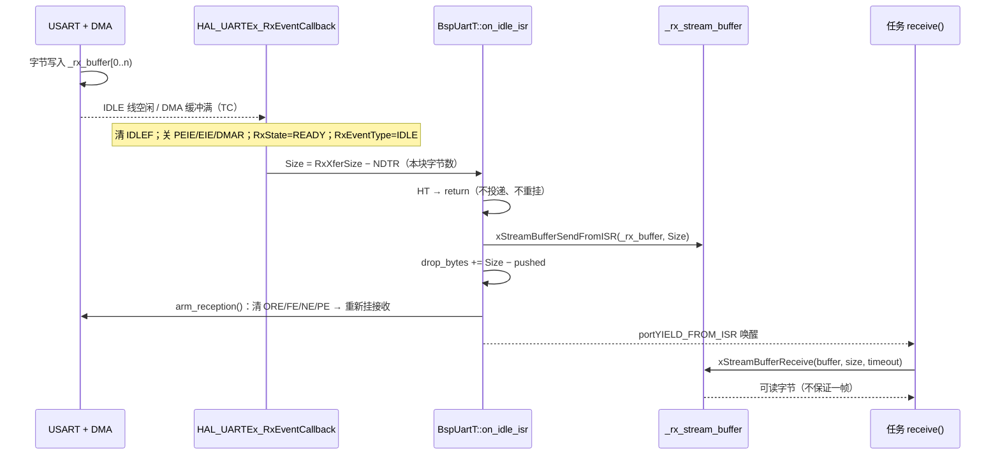
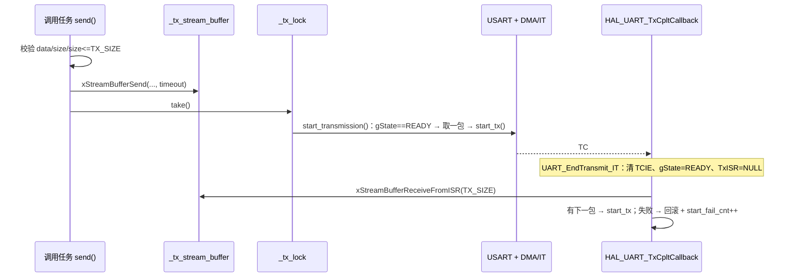
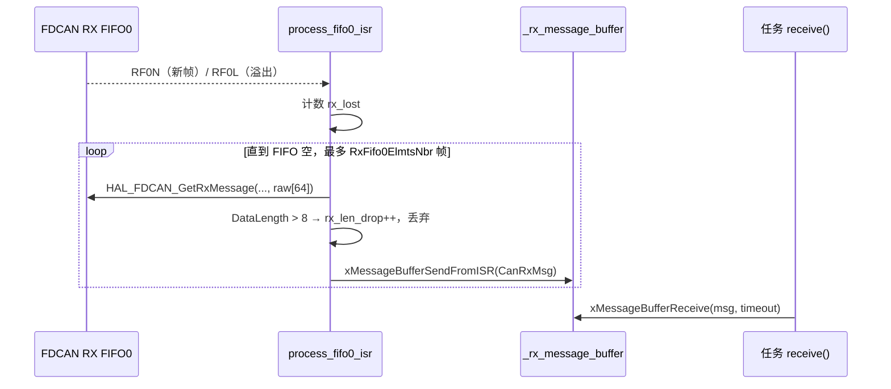
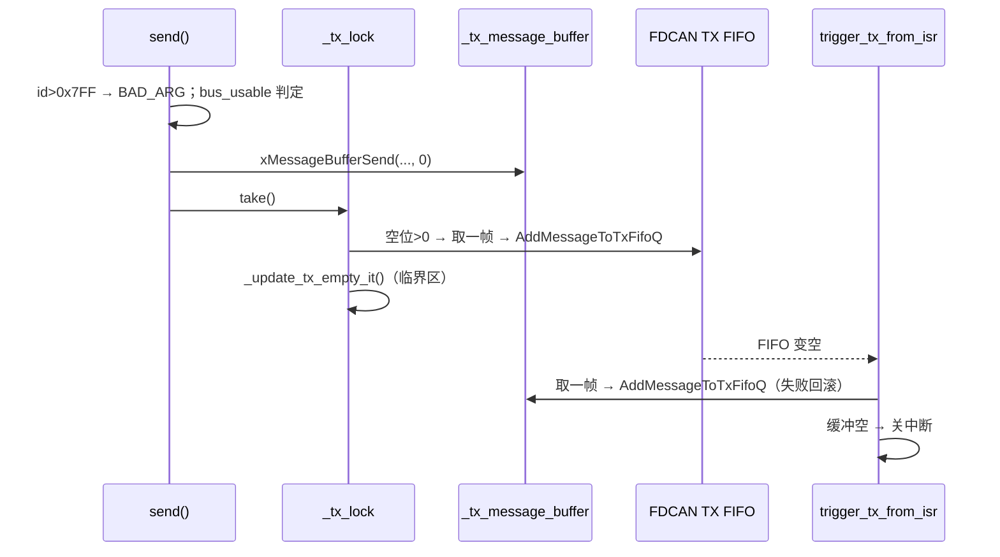

# BSP 层手册

> 代码：`User/Bsp/`　引脚：[引脚分配与冲突](../../Docs/hardware/引脚分配与冲突.md)
> `.dma_buffer`：[链接脚本改动](../../Docs/build/链接脚本改动.md)　编码：[编码规范](../../Docs/spec/编码规范.md)

## 1. 定位与边界

BSP 只搬外设数据：报文 / 字节 / 电平进软件缓冲，数据 / 占空比出硬件；不认识设备与业务。

| 可以放进来                            | 不能放进来                       |
| ------------------------------------- | -------------------------------- |
| 外设句柄、寄存器读写、中断回调        | 协议解析（字节 → 物理量）       |
| 字节流 / 报文缓冲、诊断计数、通道恢复 | 节点注册、设备地址表、业务状态机 |
| 板级常量（引脚、通道、PSC/ARR）       | 任何 `#include "device_*.hpp"` |

判据：本层文件出现上层头文件即放错层。依赖：`App → Module → Device → Bsp`；
BSP 只依赖 HAL、FreeRTOS、`Service/status.hpp`。

## 2. 启动与初始化链



中断时序要点：

- `HAL_Init()` 使能 SysTick 后，**中断已经可以进来**；此时任务尚未调度，ISR 里只能计数/搬字节。
- 外设中断源分两批打开：NVIC 通道在 `MX_xxx_Init()`，真正的事件（IDLE、RX FIFO0、DMA 完成）
  在 `bsp_init()` 的 `init()` / `arm_reception()` / `ActivateNotification()` 里。
- `bsp_init()` 返回时，UART 接收与 CAN 接收中断已生效；最先可能进 ISR 的是 UART IDLE / DMA 完成。
- `osKernelStart()` 之前进 ISR 没有任务可唤醒；`FromISR` 的唤醒从调度器运行后才有效。

1. `all_init()` 在 `osKernelStart()` **之前**（`MX_FREERTOS_Init()` 内）：可建 StreamBuffer / Mutex /
   EventGroup / 任务，**不可**阻塞等待。
2. 每条 `init()` 用 `configASSERT(... == Status::OK)` 收口，失败关中断死循环；断点落在出问题的驱动上，
   所以 `bsp_init()` 无返回值。
3. 顺序：`bsp_dwt` 最先（其它驱动记时间戳）；`DeviceServo::init()` 读 `BspPwm::get_counter_clk_hz()`，
   PWM 必须在设备层之前。

## 3. `bsp_uart`：从 IDLE 中断到任务取字节

### 3.1 类型与配置

```cpp
template <typename Transport, size_t RX_SIZE, size_t TX_SIZE>
class BspUartT;
```

- `Transport`：`DmaTransport` / `ItTransport`，只封装启动收发、健康判据、已发字节数、中止通道。
- `RX_SIZE`：接收流缓冲 + `_rx_buffer[RX_SIZE]`；`TX_SIZE`：发送流缓冲 + `_tx_buffer[TX_SIZE]` + `printf` 缓冲。
- `Config{huart, mode, baudrate}`：`mode` = `RxOnly / TxOnly / TxRx`；`baudrate` **只用于 TX 卡死阈值**，
  真实波特率与帧格式在 CubeMX 的 `huartX.Init`，驱动不改。`check_format()` 只回读 `huart->Init`。

**调用示例（任务上下文）**

```cpp
uint8_t tx[8] = {0x01, 0x02, 0x03, 0x04, 0x05, 0x06, 0x07, 0x08};
uint8_t rx[32];
size_t  got = 0;

(void)bsp_uart1.send(tx, sizeof(tx));            // 入流缓冲；默认等到全部入队
(void)bsp_uart1.send(tx, 4, 10);                 // 最多等 10 ms；TIMEOUT = 只进去一部分
(void)bsp_uart1.printf("tick=%d\r\n", 42);       // 非阻塞，入队固定等 10 ms

if (bsp_uart1.receive(rx, sizeof(rx), 10, &got) == Status::OK)
{
  // got 字节：可能是半帧，也可能多帧；切帧由上层负责
}
```

- `send()` 单次不得超过 `TX_SIZE`（本工程的实例是 128），超了返回 `BAD_ARG`；要发长数据自己分段。
- `receive()` 的 timeout 单位毫秒，`portMAX_DELAY` 表示一直等；返回 `OK` 仅表示读到至少 1 字节。
- 多个任务同时 `send()` / `printf()` 是安全的；`receive()` 的字节只有一个消费者（与设备层共用时先确认谁在消费）。
- 初始化已在 `bsp_init()` 里完成，业务代码只调收发。

**在设备层如何用**（设备只把串口当模板参数，不 include `bsp_cfg.hpp`）：

```cpp
DeviceEmmv5T<decltype(bsp_uart7)> motor({bsp_uart7, 1});
motor.init();                                   // 创建内部 RX 任务，之后业务不要再调 update()
motor.request_position();
int32_t pos = 0;
if (motor.get_position(pos)) { /* ... */ }
```

### 3.2 接收链（DMA 与 IT 相同）



**HAL 进回调前做了什么**

| 事件                 | HAL 的动作                                                                                                                                                | 回调参数                             |
| -------------------- | --------------------------------------------------------------------------------------------------------------------------------------------------------- | ------------------------------------ |
| IDLE（DMA 普通模式） | 清 `IDLEF`；`RxXferCount = NDTR`；关 `PEIE`/`EIE`/`DMAR`；`RxState = READY`；`ReceptionType = STANDARD`；关 `IDLEIE`；`HAL_DMA_Abort()` | `Size = RxXferSize − RxXferCount` |
| IDLE（IT / FIFO）    | 清 `IDLEF`；关 `RXNEIE`/`PEIE`/`EIE`（FIFO 另关 `RXFTIE`）；`RxState = READY`；`RxISR = NULL`；关 `IDLEIE`                                | `Size = RxXferSize − RxXferCount` |
| TC（DMA 缓冲满）     | `RxEventType = TC`                                                                                                                                      | `Size = RxXferSize`（整块）        |
| HT（DMA 半传）       | `RxEventType = HT`，DMA 仍在跑                                                                                                                          | `Size = RxXferSize / 2`            |

- 进 `on_idle_isr` 时 **DMA/IT 已停、`RxState` 已 READY**，`_rx_buffer[0..Size)` 就是本块数据，
  可以直接投递并重新 arm。
- **HT 不是帧边界**：DMA 还在同一块缓冲里写，投递会重复且破坏数据，必须丢弃。

**`on_idle_isr()` 内部逐步**

```cpp
if (_huart == nullptr || !_rx_enabled()) return;         // 未初始化 / 只发模式
if (_huart->RxEventType == HAL_UART_RXEVENT_HT) return;  // 半传不是帧边界

size_t pushed = xStreamBufferSendFromISR(_rx_stream_buffer, _rx_buffer, size, woken);
_rx_drop_bytes += (size - pushed);                       // 流缓冲满只丢尾部

(void)arm_reception();                                   // 清 UART 错误标志 → 重新挂接收
```

1. 投递的是 `_rx_buffer` 的**前 `Size` 字节**，不是从某个偏移开始。
2. `SendFromISR` 只写入能放下的部分，剩余丢弃并计入 `drop_bytes`（正常应为 0）。
3. `arm_reception()` 失败不在中断里重试（HAL Abort 阻塞）：只 `arm_fail_cnt++`，
   `sys_task` 的 `rx_recover()` 在 10 ms 内用 `get_rx_health()` 发现并重建。
4. 回调返回后 `portYIELD_FROM_ISR(woken)` 让被流缓冲解除阻塞的任务立即运行。
5. ISR 只搬字节，不切帧、不解析协议。

`arm_reception()` 先清 `PEF/FEF/NEF/OREF`（有挂起错误时 HAL 拒绝启动）；DMA 的 TC/HT/TE/FE/DME 由
`HAL_DMA_Abort()` 用 IFCR 一次清完 6 个。
`abort_reception()` = `Transport::abort_rx()` + 清 `CR1.IDLEIE`，只动 RX。

### 3.3 发送链



**HAL 进回调前做了什么**（`UART_EndTransmit_IT`）：清 `CR1.TCIE` → `gState = READY` → `TxISR = NULL`
→ 调 `HAL_UART_TxCpltCallback(huart)`。所以回调里通道一定空闲，**不需要 `_tx_lock`**。

**`start_transmission_from_isr()` 内部逐步**

```cpp
if (_huart == nullptr || _tx_stream_buffer == nullptr || !_tx_enabled()) return;
if (_huart->gState != HAL_UART_STATE_READY) { _tx_isr_skip_cnt++; return; } // 数据留在缓冲

size_t n = xStreamBufferReceiveFromISR(_tx_stream_buffer, _tx_buffer, TX_SIZE, woken);
if (n == 0U) { _tx_inflight_len = 0; return; }                 // 上一批已发完，无新数据

if (!Transport::start_tx(_huart, _tx_buffer, n)) {             // 启动失败
  (void)xStreamBufferSendFromISR(_tx_stream_buffer, _tx_buffer, n, woken); // 回滚
  _tx_inflight_len = 0;
  _tx_start_fail_cnt++;
} else {
  _tx_last_activity_tick = xTaskGetTickCountFromISR();         // 供 tx_recover 判卡死
  _tx_inflight_len = n;
}
```

1. `gState != READY` 说明通道被别的传输占着：不取数据（取了还得回滚），记 `isr_skip_cnt`，
   数据留在流缓冲，等 `tx_recover()` 下个巡检周期重发。
2. 一次最多取 `TX_SIZE` 字节；`_tx_inflight_len` 是「已交给 Transport、还没确认发完」的长度，
   `tx_recover()` 用它算续发起点。
3. 启动失败必须把刚取出的字节写回流缓冲（刚取 `n` 字节，至少有 `n` 字节空间，回滚必定成功）。
4. 成功时记 `_tx_last_activity_tick`：`tx_recover()` 用「多久没推进」区分正常发送与卡死。
5. 每包发完进一次本回调；流缓冲为空时只清 `_tx_inflight_len`，不启动也不关中断。

任务侧 `_tx_lock` 保护 `_tx_buffer` 与「判忙 → 取包 → 启动」三步，防止两个任务同时写 DMA 正在读的缓冲。
ISR 只在 TC 回调里取包；TC 期间 HAL 已交还通道，任务也不能运行，所以两端不会并发。

**`on_error_isr()`**：`gState != READY` → `_tx_error_cnt++`；`ErrorCode` 含 `PE|NE|FE|ORE|RTO` →
`_rx_hw_error_cnt++`。只计数，恢复交给任务侧的 `tx_recover()` / `rx_recover()`。

**任务侧 `send()`**：`size > TX_SIZE` → `BAD_ARG`（`xStreamBufferSend` 一次发不完会永久阻塞）；
返回 `OK` 只表示整帧进流缓冲。`printf()` 用 `_printf_lock` 保护共享格式化缓冲，入队固定等 10 ms。

### 3.4 诊断与恢复

| 计数                  | 位置       | 含义                                         |
| --------------------- | ---------- | -------------------------------------------- |
| `arm_fail_cnt`      | `RxDiag` | 启动接收失败次数（含 init 第一次）；正常恒 0 |
| `drop_bytes`        | `RxDiag` | 流缓冲区满丢掉的字节                         |
| `hw_error_cnt`      | `RxDiag` | PE / NE / FE / ORE / RTO 次数                |
| `error_cnt`         | `RxDiag` | `rx_recover()` 真正重建 RX 的次数          |
| `drop_bytes`        | `TxDiag` | 入队失败丢掉的字节                           |
| `start_fail_cnt`    | `TxDiag` | 启动发送失败次数（任务 + ISR）               |
| `isr_skip_cnt`      | `TxDiag` | 中断里通道不空闲、跳过续传的次数             |
| `stall_recover_cnt` | `TxDiag` | 巡检判定卡死并恢复成功的次数                 |
| `error_cnt`         | `TxDiag` | TX 进入错误回调的次数                        |

- `tx_recover()`：有在途（`_tx_inflight_len > 0`）或有排队，且闲置 ≥ `TX_SIZE × 20 × 1000 / baudrate` ms
  （一包 10 bit/字节 × 2）；用 `Transport::tx_sent()` 算已发量，`abort_tx()` 后只补剩余。
- `rx_recover()`：`_rx_should_run == false` 不算故障；`get_rx_health() == OK` 直接返回；否则
  `abort_reception()` + `arm_reception()`。
- `_rx_should_run` = **期望**在收，失败不永久置假。

**健康判据**（`get_rx_health()` 三态 `OK / STOPPED / INCONSISTENT`）：

| Transport | `rx_ok()`                                                                                                              |
| --------- | ------------------------------------------------------------------------------------------------------------------------ |
| DMA       | `RxState == BUSY_RX` **且** `CR3.DMAR == 1` **且** `DMA_SxCR.EN == 1`                                  |
| IT        | `RxState == BUSY_RX` **且**（`CR1.RXNEIE` 与 `CR1.IDLEIE` 都开，或 FIFO 模式下 `CR3.RXFTIE` + `IDLEIE`） |

IT 两种都要认：HAL 在 `FIFOMODE_ENABLE` 且长度 ≥ 阈值时走 `UART_RxISR_8BIT_FIFOEN`，只开 `CR3.RXFTIE`；
小于阈值可能退回逐字节 `RXNEIE`。

### 3.5 新增一路串口：参数怎么改

**CubeMX（`DM_MC02.ioc`）**

| 参数                          | 在哪改                           | 本工程取值 / 说明                                                                                      |
| ----------------------------- | -------------------------------- | ------------------------------------------------------------------------------------------------------ |
| 引脚与复用                    | Pinout & Configuration → USARTx | TX/RX 选对应 AF；RS485 还要选 DE 引脚                                                                  |
| 波特率 / 字长 / 校验 / 停止位 | USARTx → Parameter Settings     | 常见 8N1；SBUS 是 100000 / 9B / Even / 2（`UART_WORDLENGTH_9B` 已含校验位）                          |
| 收发方向                      | Mode                             | Asynchronous（全双工）/ Rx Only                                                                        |
| DMA                           | DMA Settings                     | DMA 实例必须配 RX + TX 两条流；IT 实例不配                                                             |
| 中断                          | NVIC Settings                    | USARTx global interrupt 使能，优先级 **5**（= `configLIBRARY_MAX_SYSCALL_INTERRUPT_PRIORITY`） |
| RS485                         | USARTx → Advanced Features      | 选 Hardware DE，CubeMX 生成 `HAL_RS485Ex_Init()`                                                     |

**模板参数（决定 RAM 与行为）**

| 选择            | 怎么改                                                         | 代价 / 约束                                                                                     |
| --------------- | -------------------------------------------------------------- | ----------------------------------------------------------------------------------------------- |
| DMA 还是 IT     | 模板第一个参数 `uart_detail::DmaTransport` / `ItTransport` | DMA 要配流、实例必须放 `RAM_D1`；IT 省 DMA，但高波特率 CPU 负担大                             |
| `RX_SIZE`     | 模板第二个参数                                                 | 接收流缓冲区 + 接收暂存区各 `RX_SIZE` 字节                                                    |
| `TX_SIZE`     | 模板第三个参数                                                 | 发送流缓冲区 + 发送暂存区 + `printf` 缓冲各 `TX_SIZE` 字节；`send()` 单次不得超过它       |
| 单实例 RAM 粗算 | —                                                             | `RX_SIZE + 2 × TX_SIZE` 字节，另加流缓冲控制块与两把锁                                       |
| 收发模式        | `Config{huart, mode, baudrate}` 的 `mode`                  | `TxRx` / `RxOnly` / `TxOnly`                                                              |
| `baudrate`    | `Config` 第三个字段                                          | 只用于算 TX 卡死阈值（一包时间 × 2），**必须与 CubeMX 的 `huartX.Init.BaudRate` 一致** |

`static_assert` 限制 `1 ≤ RX_SIZE/TX_SIZE ≤ 65535`（HAL 的收发长度是 `uint16_t`）。

**四处同步**

1. `bsp_uart.cpp` 顶部显式实例化（同类型已有则跳过）：
   `template class BspUartT<uart_detail::DmaTransport, 128, 128>;`
2. 三张分发表（`HAL_UARTEx_RxEventCallback` / `HAL_UART_TxCpltCallback` / `HAL_UART_ErrorCallback`）
   各加 `else if (huart == &huartX)`——漏一条 = 能收不能发 / 出错不计数。
3. `bsp_cfg.hpp` `extern` + `bsp_cfg.cpp` 实例（DMA 加 `.dma_buffer`）+ `bsp_init()` 的 `configASSERT`。
4. `sys_task.cpp` 巡检：DMA 进 `patrol_uarts[]`，IT 单独一行；否则卡死不恢复。

**示例：UART6，921600 8N1，DMA，128/128**

```cpp
__attribute__((section(".dma_buffer")))
BspUartT<uart_detail::DmaTransport, 128, 128> bsp_uart6({&huart6, UartMode::TxRx, 921600U});
```

**确认**：测试里调
`bsp_uart6.check_format(921600U, UART_WORDLENGTH_8B, UART_PARITY_NONE, UART_STOPBITS_1)`，
false = CubeMX 与 `Config` 有一边错。只读 `huart->Init`，不改配置。

## 4. `bsp_can`：Message Buffer + FIFO 中断

### 4.1 结构

- 接收、发送各一个 FreeRTOS **Message Buffer**，容量 `(sizeof(msg) + 4) × DEPTH`（4 字节是消息长度头）。
- `CanRxMsg{header, data[8]}`、`CanTxMsg{std_id, data[8]}`：只支持**经典 CAN、标准帧、固定 8 字节**。
- 滤波器 `FDCAN_FILTER_RANGE` 0x000~0x7FF 全收进 FIFO0，远程帧不接收；**不做 ID 级过滤**，
  ID 由上层判断（如 `DjiMotorGroupT::update()`）。

**调用示例**

```cpp
uint8_t data[8] = {0};
data[0] = 0x01;
if (bsp_can3.send(0x1FE, data) != Status::OK)
{
  // FULL = 软件发送缓冲满；BUSY = Bus-Off 或恢复中；BAD_ARG = ID > 0x7FF
}

CanRxMsg rx {};
if (bsp_can3.receive(&rx, 0) == Status::OK)   // 0 = 不等待；portMAX_DELAY = 一直等
{
  const uint32_t id = rx.header.Identifier;   // rx.data[0..8)
}
```

- 同一条总线只能有一个任务调 `receive()`，否则帧被瓜分。
- `send()` 返回 `OK` 只表示进了软件发送缓冲，不代表已上总线。

### 4.2 接收链



- 必须一次读空 FIFO：RF0N 是「写入一帧」事件且 HAL 已清除，只读一帧则剩余帧不再触发中断。
- `HAL_FDCAN_GetRxMessage` 按 DLC 拷贝（DLC=15 → 64 字节），故先收进 `raw[64]` 再拷 8 字节。
- 软件缓冲满只丢当前帧并计 `rx_dropped`，循环继续读空硬件 FIFO。
- 一条总线只有一个 `receive()` 消费者。

**`process_fifo0_isr()` 内部逐步**

1. `_hfdcan` / `_rx_message_buffer` 为空 → 返回。
2. `its & RX_FIFO0_MESSAGE_LOST` → `rx_lost++`（硬件 FIFO 已丢帧）。
3. 没有 `NEW_MESSAGE` 位 → 返回（本次可能只有溢出位）。
4. 循环 `GetRxFifoFillLevel > 0`，最多 `RxFifo0ElmtsNbr` 帧：`GetRxMessage → raw[64]`；
   `DataLength > 8` → `rx_len_drop++` 并 `continue`；`memcpy` 8 字节 → `xMessageBufferSendFromISR`
   （失败 `rx_dropped++`）。
5. 循环内不 yield；返回后由 `HAL_FDCAN_RxFifo0Callback` 统一 `portYIELD_FROM_ISR`。

### 4.3 发送链与 TX-FIFO-EMPTY 的开关



- `bus_usable = State==BUSY && !recovering && PSR.BO==0 && CCCR.INIT==0`，否则 `BUSY`。
- 不用 TX_COMPLETE（FIFO 模式 `BufferIndexes=0` 无回调）；TX-FIFO-EMPTY 按需开关：有帧开、无帧关。
- 「判空」与「写 IE」在任务侧同临界区，否则中断里刚开的中断被旧值覆盖（延迟一周期，不丢帧）。
- 写硬件 FIFO 失败要放回 Message Buffer（刚取 1 帧，必然放得下），并记 `tx_dropped`。

**`trigger_tx_from_isr()` 内部逐步**

1. 缓冲 / 句柄为空 → 返回。
2. `HAL_FDCAN_GetTxFifoFreeLevel > 0` → `xMessageBufferReceiveFromISR` 取一帧；
   `HAL_FDCAN_AddMessageToTxFifoQ` 失败 → `xMessageBufferSendFromISR` 回滚 + `tx_dropped++`。
3. 末尾 `_set_tx_empty_it(!IsEmpty)`：软件缓冲空就关中断，避免 FIFO 每次变空都进中断。
4. 不加锁：HAL 只在 FIFO 变空时调本回调，任务不能在 ISR 期间运行；空位检查的 TOCTOU 失败会被回滚。

### 4.4 Bus-Off 恢复（`service_recovery()`）

`PSR.BO` 由 0 变 1 时，在一个临界区内：

1. `recovering = true`、`bus_off_events++`、清空软件收发缓冲。
2. `TXBCR = TXBRP` 取消所有未发帧，避免恢复瞬间发出过期控制帧。
3. 每 100 ms：若 `CCCR.INIT` 被硬件再次置位，再次请求取消并清 `CCCR.INIT`，让 M_CAN 自行重同步
   （129 × 11 隐性位）。**不重新初始化外设、不清 message RAM**。
4. 结束：`BO` 清、`INIT` 清、`TXBRP == 0` → `recovering = false`，记成功次数与最长耗时。

100 ms 限流防反复打断恢复序列；`recovering` 期间 `send()` 一律 `BUSY`。
`tx_recover()` 只在「有帧 + FIFO 有空位」时补写一次，并补开被丢的 TX-FIFO-EMPTY 中断；Bus-Off 时直接返回。

### 4.5 诊断字段怎么读

| 字段                                           | 正常值 | 异常含义                                      |
| ---------------------------------------------- | ------ | --------------------------------------------- |
| `bus_off_events`                             | 0      | 进出 Bus-Off 各计一次（IR.BO 是状态变化事件） |
| `err_passive` / `err_warning`              | 0      | 进入错误被动 / 错误警告的次数                 |
| `recovery_attempts` / `recovery_successes` | 相等   | 尝试次数多于成功次数 = 总线长期故障           |
| `recovery_max_ticks`                         | 小     | 单次恢复最长耗时                              |
| `rx_dropped`                                 | 0      | 软件接收缓冲满：消费太慢                      |
| `rx_lost`                                    | 0      | 硬件 FIFO 溢出：中断被长时间屏蔽或消费太慢    |
| `rx_len_drop`                                | 0      | 收到 FD / 非法 DLC 帧（不是本层支持的格式）   |
| `tx_dropped`                                 | 0      | 写硬件 FIFO 失败后回滚的次数                  |
| `tx_buf_full`                                | 0      | 软件发送缓冲满                                |
| `tx_stall_recover`                           | 0      | ISR 丢唤醒、由巡检补发                        |
| `tx_it_fail`                                 | 0      | 开关 TX-FIFO-EMPTY 中断时 HAL 忙              |

`_reset_hardware()` 调 `HAL_FDCAN_Stop()`，它**不清硬件 TX FIFO**；自动重传开启时，重启后残留帧
可能再发一次——重新初始化后不要立刻下发控制帧。

### 4.6 新增一条 CAN 总线：参数怎么改

**CubeMX（FDCANx）**

| 参数          | 在哪改                                          | 本工程取值 / 怎么算                                                                |
| ------------- | ----------------------------------------------- | ---------------------------------------------------------------------------------- |
| 内核时钟      | Clock Configuration → FDCAN                    | PLL2Q = **96 MHz**（HSE 24 MHz → PLL2M 2 → VCO 192 MHz → Q 2）            |
| 帧格式        | Parameter Settings → Frame Format              | Classic CAN（本驱动只支持经典帧 + 标准 ID + 8 字节）                               |
| 模式          | Mode                                            | Normal；调试可用 Internal Loopback                                                 |
| 自动重传      | Auto Retransmission                             | Enable（与「重启后残留帧可能重发一次」有关）                                       |
| 位时序        | Nominal Prescaler / Time Seg1 / Time Seg2 / SJW | 6 / 11 / 4 / 1 → 每位 16 tq → 96 MHz ÷ (6×16) = **1 Mbit/s**，采样点 75% |
| RX FIFO0 深度 | Rx Fifo0 Elmts Nbr                              | 16（`process_fifo0_isr()` 单次最多搬这么多帧）                                   |
| TX FIFO 深度  | Tx Fifo Queue Elmts Nbr                         | 16，模式 FIFO                                                                      |
| 滤波器数量    | Std Filters Nbr                                 | 1（代码里配成 0x000~0x7FF 全收）                                                   |
| 中断          | NVIC                                            | FDCANx interrupt 0/1 使能，优先级 **5**                                      |

`bitrate = 96 MHz / (PSC × (1 + Seg1 + Seg2))`，采样点 `(1 + Seg1) / (1 + Seg1 + Seg2)` 取 75%~87.5%。
例：500 kbit/s → `PSC = 12`、`Seg1 = 11`、`Seg2 = 4`（12 × 16 = 192）。

**深度（模板参数）**

| 参数         | 怎么改                                 | 代价                                                              |
| ------------ | -------------------------------------- | ----------------------------------------------------------------- |
| `RX_DEPTH` | `BspCanT<RX_DEPTH, TX_DEPTH>` 第一个 | 接收 MessageBuffer = `(sizeof(CanRxMsg) + 4) × RX_DEPTH` 字节  |
| `TX_DEPTH` | 第二个                                 | 发送 MessageBuffer = `(sizeof(CanTxMsg) + 4) × TX_DEPTH` 字节  |
| 深度够不够   | 看诊断                                 | 软件满 → `tx_buf_full` / `rx_dropped`；硬件满 → `rx_lost` |

**滤波器（可选）**：改 `_configure_hardware()` 的 `sFilterConfig`（`FilterType` + `FilterID1/2`）并同步
`StdFiltersNbr`；硬件过滤后设备层 `update()` 收不到那些帧。

**四处同步**

1. `bsp_can.cpp` 顶部显式实例化：`template class BspCanT<16, 16>;`（同类型已有则跳过）。
2. 三张分发表各加一条 `else if (hfdcan == &hfdcanX)`：
   `HAL_FDCAN_RxFifo0Callback` → `process_fifo0_isr()`；
   `HAL_FDCAN_TxFifoEmptyCallback` → `trigger_tx_from_isr()`；
   `HAL_FDCAN_ErrorStatusCallback` → `process_error_isr()`。
   **漏加 = 该总线收帧没人处理 / 发不出去 / Bus-Off 不计诊断。**
3. `bsp_cfg.hpp` 加 `extern`；`bsp_cfg.cpp` 加实例与 `bsp_init()` 里的 `configASSERT`。
4. `sys_task.cpp` 的 `patrol_cans[]` 加一项，否则 Bus-Off 不会被恢复。

**示例：CAN4，1 Mbit/s，收发各 8 帧**

```cpp
BspCanT<8, 8> bsp_can4({&hfdcan4, "CAN4"});   // bsp_cfg.cpp
// bsp_can.cpp 顶部：template class BspCanT<8, 8>;
```

**确认**：`is_ready()` 只证明句柄非空。位率用分析仪量一位时间（1 Mbit/s → 1 µs/位），
或对端同参数回帧，看 `err_warning` 是否保持 0。

## 5. `bsp_pwm`：CCR / ARR 与两条换算式

- `counter_clk = timer_clk_hz / (prescaler + 1)`。本板 275 MHz，舵机 `PSC=274` → 1 MHz，
  `ARR=19999` → 20000 计数 = 20 ms = 50 Hz；1 计数 = 1 µs，`set_pulse_us(1500)` = 1500 计数。
- `ccr = round(duty% × (ARR+1) / 100)`，限幅 `[0, ARR+1]`。
- 脉宽：`period_us = (ARR+1) × 1e6 / counter_clk`，`duty = width_us × 100 / period_us`。
- 改频率：`ARR = counter_clk / freq − 1`，PSC 不动；上限按 `IS_TIM_32B_COUNTER_INSTANCE()`
  取 32 位 / 16 位；随后重算 CCR 保持占空比。
- `init()` 幂等（`_initialized`）：`HAL_TIM_PWM_Start()` 置 BUSY 且不复位，重复调用返回 `HAL_ERROR`；
  启动前先写 CCR=0，保证上电 0%。
- 通道合法性用 `IS_TIM_CCX_INSTANCE()`。**不能写 `channel == 0`**：`TIM_CHANNEL_1 == 0`，
  会误杀 CH1（本工程 pwm2/pwm4 上电断言过）。
- 同定时器共用计数器与 ARR：`bsp_pwm1`/`bsp_pwm2` 必须同频，`bsp_pwm3`/`bsp_pwm4` 同理。
- 含浮点，只在任务上下文调用。

**调用示例**

```cpp
bsp_pwm1.set_duty(7.5f);          // 占空比 7.5%
bsp_pwm1.set_pulse_us(1500.0f);   // 舵机中位（本板 1 计数 = 1 µs）
bsp_pwm2.set_freq(3000U);         // 改频率会同时影响 TIM1 全部通道
bsp_pwm1.off();                   // CCR = 0，引脚保持低电平
```

### 5.1 新增一路 PWM：参数怎么算

**顺序：先定频率 → 选 PSC → 算 ARR → 填 Config。**

1. `timer_clk_hz` 填定时器内核时钟 **275 MHz**（APB 137.5 × 2，因为 APB 预分频 ≠ 1），不是 137.5 MHz。
2. `counter_clk = 275 MHz / (PSC + 1)`；PSC 越大计数越慢、可用 ARR 越大。
3. `ARR = round(counter_clk / f) − 1`；16 位定时器 `ARR ≤ 65535`，TIM2/TIM5 是 32 位（`IS_TIM_32B_COUNTER_INSTANCE()`）。

| 用途   | 频率                 | PSC | counter_clk | ARR          | 分辨率     |
| ------ | -------------------- | --- | ----------- | ------------ | ---------- |
| 舵机   | 50 Hz                | 274 | 1 MHz       | 19999        | 1 µs/计数 |
| 蜂鸣器 | 由 `tone()` 动态改 | 23  | 11.4583 MHz | 1999（初始） | 87 ns/计数 |
| 陀螺仪 | 按器件手册           | 23  | 11.4583 MHz | 9999         | 87 ns/计数 |

4. `Config{&htimX, TIM_CHANNEL_y, 275000000UL, PSC, ARR, 上电占空比}`（参数顺序 = 字段顺序）；`init()` 先 CCR=0
   再启动，随后按该占空比输出（默认 0）。
5. **同定时器共用 PSC 与 ARR**：要不同频率必须换定时器（改 PSC 影响全部通道）；同频多通道只差 CCR。

**步骤**：CubeMX 把 TIMx CHy 设为 PWM Generation CHy（引脚自动 AF，Clock Source = Internal）；
`bsp_cfg.hpp` 加 `extern`；`bsp_cfg.cpp` 加实例 + `bsp_init()` 断言。无中断、无回调、无模板实例化。

**确认**：`get_freq_hz()` / `get_duty_pct()` 是内部计算值；真实波形用示波器量。上电应 0% 占空比。

## 6. `bsp_key`：消抖状态机

```
        电平跳变                     稳定按住 ≥ long_press_cnt × T
 NONE ──────────► 计数 cnt ──(cnt ≥ debounce_cnt)──► PRESS ──────────────► LONG（只触发一次）
                                                       │
                                                       └─(阈值内松手)─► SHORT
```

- `消抖时间 = debounce_cnt × 轮询周期`，`长按时间 = long_press_cnt × 轮询周期`。本工程
  `{true, 1, 5}` + 200 ms → 200 ms 消抖 / 1 s 长按。
- `init()` 以当前电平作 `_last_stable`：上电已按住不产生 `PRESS`。
- 确认按下时把已累计消抖次数作为 `_hold_cnt` 初值，长按从**电平跳变那一刻**起算。
- 长按后松手不产生 `SHORT`（`_long_fired`），避免一次长按被当成两次操作。
- `poll()` 必须同一任务严格等周期；非线程安全，无中断。
- 一次「按下→松手」只得 `PRESS + SHORT` 或 `PRESS + LONG`。

**调用示例（`key_task`，200 ms 一次）**

```cpp
for (;;)
{
  switch (key_user.poll())
  {
    case BspKey::Event::PRESS: /* ... */ break;
    case BspKey::Event::SHORT: /* ... */ break;
    case BspKey::Event::LONG:  /* ... */ break;
    default: break;
  }
  vTaskDelay(pdMS_TO_TICKS(200));
}
```

## 7. `bsp_dwt`：CYCCNT 与回绕

- 初始化：`DEMCR.TRCENA`（脱机运行必须自己置位）→ `DWT->LAR = 0xC5ACCE55` → `CYCCNT = 0` →
  使能 `CYCCNTENA` → 等约 8 周期 → 再清零。
- 基准 = `SYSCLK / D1CPRE`。本工程 550 MHz → 1 计数 ≈ 1.818 ns，32 位 **7.809 s 回绕**。
- `get_delta_s(&last)`：无符号差值，间隔 < 7.809 s 恒正；无状态，可在 ISR 调用。
- `get_time_*`：唯一状态更新点是 `update_timeline()`，**先调用再读 `_base_s`**。
  写成 `_base_s + update_timeline()/...` 会因求值顺序在回绕时少算一圈（倒退 7.809 s）。
- 任意两次绝对时间间隔必须 < 7.809 s；本工程靠 `sys_task` 每 10 ms 调 `Online::update()` 满足心跳。
- `delay_*` 纯忙等，临界区可用；毫秒级以上用 `vTaskDelay()`。
- CPU 进 sleep/stop 时停止计数。

**调用示例**

```cpp
uint32_t mark = 0U;
(void)bsp_dwt.get_delta_s(&mark);                  // 首次只取基准，结果丢弃
/* 被测代码 */
const double dt_us = bsp_dwt.get_delta_s(&mark) * 1e6;

const double now_ms = bsp_dwt.get_time_ms();       // 绝对时间（需 < 7.809 s 心跳）
bsp_dwt.delay_us(500.0);                           // 忙等 500 µs
```

## 8. `bsp_gpio`

构造绑定 `{port, pin}`；方向与上下拉由 `MX_GPIO_Init()` 配。
接口：`set()` / `reset()` / `toggle()` / `set_level(bool)` / `get_level()`。

```cpp
power_24v_1.set();                        // 高电平
power_24v_1.reset();                      // 低电平
btb_pa5.toggle();                         // 翻转
const bool level = gyro_acc_cs.get_level();
```

## 9. 上下文模型汇总

| 接口                                                | 谁调用         | 上下文     | 阻塞                             |
| --------------------------------------------------- | -------------- | ---------- | -------------------------------- |
| `BspUartT::send` / `receive` / `printf`       | 任意任务       | 任务       | 可阻塞（默认 `portMAX_DELAY`） |
| `BspUartT::tx_recover` / `rx_recover`           | `sys_task`   | 任务       | 否（`tx_recover` 取锁等待 0）  |
| `BspCanT::send`                                   | 设备任务       | 任务       | 否                               |
| `BspCanT::receive`                                | 一个消费者任务 | 任务       | 可阻塞                           |
| `BspCanT::service_recovery`                       | `sys_task`   | 任务       | 否（临界区）                     |
| `HAL_*_Callback` → `*_isr` / `process_*_isr` | HAL            | ISR        | 否                               |
| `BspPwm::*`                                       | 设备层         | 任务       | 否（含浮点）                     |
| `BspKey::poll`                                    | `key_task`   | 任务       | 否                               |
| `BspDwt::get_delta_s`                             | 任意           | 任务 / ISR | 否                               |
| `BspDwt::get_time_*`                              | 任意任务       | 任务       | 否（BUT 需 < 7.809 s 心跳）      |

中断优先级统一 5（= `configLIBRARY_MAX_SYSCALL_INTERRUPT_PRIORITY`），中断里可调 `...FromISR()`；
数值 0~4 的中断不被临界区屏蔽。

## 10. 反模式

| 写法                                             | 为什么不行                                                |
| ------------------------------------------------ | --------------------------------------------------------- |
| 在 ISR 里调 `HAL_UART_AbortReceive` / 恢复流程 | HAL 内部阻塞，中断里会卡死；只计数，恢复交给任务          |
| 两个任务都调同一条总线的 `receive()`           | 帧被瓜分，两边都不完整                                    |
| 在 ISR 里解析协议                                | 中断时间不可控，且协议层需要跨块状态                      |
| `send()` 一次传 > `TX_SIZE` 字节             | `xStreamBufferSend` 会永久阻塞（已用 `BAD_ARG` 拦住） |
| 把 DMA 缓冲放到 DTCM                             | DMA1/DMA2 访问不到，收不到数据且无报错                    |
| 用 `channel == 0` 判通道非法                   | `TIM_CHANNEL_1 == 0`，会误杀 CH1                        |
| 用 `HAL_GetTick()` 做微秒级计时                | 分辨率 1 ms；用 `bsp_dwt`                               |
| 在 `HAL_FDCAN_Stop()` 后立刻下发控制帧         | 硬件 TX FIFO 未被清空，残留帧可能被重发                   |

## 11. 与代码注释的分工

- 代码保留：`@brief`、单位 / 范围 / 前置条件、就地踩坑。
- 本文覆盖：启动链、收发时序、诊断表、新增外设参数、上下文模型。
- 纯注释改动后 `FLASH` / `DTCMRAM` 字节数应不变。
