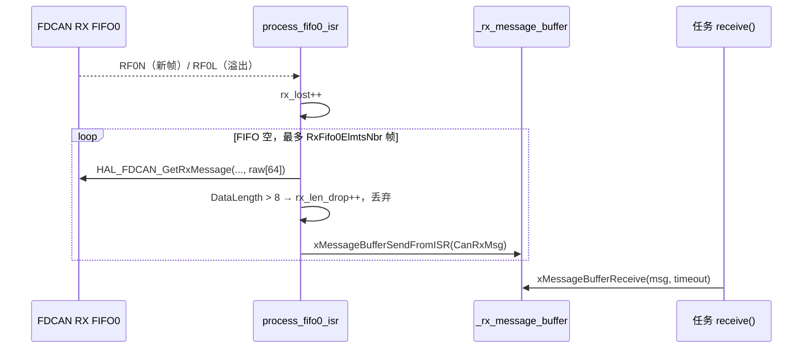
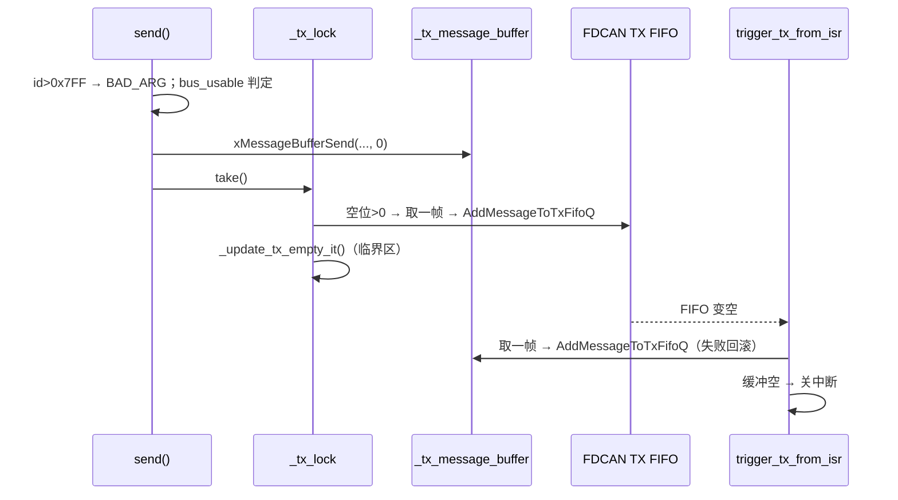

# bsp_can

> 代码：`bsp_can.hpp` / `bsp_can.cpp`　实例：`bsp_cfg.cpp`

## 0. 如何快速完整的使用（不需要了解实际实现）

```cpp
// 1) 头文件：业务侧一般只需 bsp_cfg.hpp
#include "bsp_cfg.hpp"

// 2) 实例：bsp_cfg.cpp
BspCanT<16, 16> bsp_canX({&hfdcanX, "CANx"});

// 3) 声明：bsp_cfg.hpp
extern BspCanT<16, 16> bsp_canX;

// 4) 显式实例化：bsp_can.cpp 顶部（深度不同才需要新增）
template class BspCanT<16, 16>;

// 5) HAL 回调分发：bsp_can.cpp 的 RxFifo0 / TxFifoEmpty / ErrorStatus 各加分支

// 6) 初始化：bsp_cfg.cpp 的 bsp_init()
configASSERT(bsp_canX.init() == Status::OK);

// 7) 周期恢复：sys_task.cpp 的 patrol_cans[] 加一项，否则 Bus-Off 不会恢复

// 8) CubeMX：FDCANx、位时序、NVIC 优先级 5
```

**调用示例**

```cpp
#include "bsp_cfg.hpp"

uint8_t data[8] = {0};
data[0] = 0x01;
if (bsp_can4.send(0x1FE, data) != Status::OK)
{
  // FULL = 软件发送缓冲满；BUSY = Bus-Off 或恢复中；BAD_ARG = ID > 0x7FF
}

CanRxMsg rx {};
if (bsp_can4.receive(&rx, 0) == Status::OK)   // 0 = 不等待；portMAX_DELAY = 一直等
{
  const uint32_t id = rx.header.Identifier;   // rx.data[0..8)
}
```

## 结构

- 收发各一个 FreeRTOS Message Buffer，容量 `(sizeof(msg) + 4) × DEPTH`（4 字节长度头）。
- `CanRxMsg{header, data[8]}` / `CanTxMsg{std_id, data[8]}`：仅经典 CAN、标准帧、固定 8 字节。
- 滤波器 `FDCAN_FILTER_RANGE` 0x000~0x7FF 全收进 FIFO0，远程帧不接收；不做 ID 级过滤，
  ID 由上层判断（如 `DjiMotorGroupT::update()`）。

**约束**

- 同一条总线只能有一个任务调 `receive()`。
- `send()` 返回 `OK` 只表示进了软件发送缓冲。

## 接收链



- 必须一次读空 FIFO：RF0N 是「写入一帧」事件且 HAL 已清除，只读一帧则剩余帧不再触发中断。
- `HAL_FDCAN_GetRxMessage` 按 DLC 拷贝（DLC=15 → 64 字节），先收进 `raw[64]` 再拷 8 字节。
- 软件缓冲满只丢当前帧并计 `rx_dropped`，循环继续读空硬件 FIFO。

**`process_fifo0_isr()` 内部逐步**

1. `_hfdcan` / `_rx_message_buffer` 为空 → 返回。
2. `its & RX_FIFO0_MESSAGE_LOST` → `rx_lost++`。
3. 没有 `NEW_MESSAGE` 位 → 返回。
4. 循环 `GetRxFifoFillLevel > 0`，最多 `RxFifo0ElmtsNbr` 帧：`GetRxMessage → raw[64]`；
   `DataLength > 8` → `rx_len_drop++` 并 `continue`；`memcpy` 8 字节 → `xMessageBufferSendFromISR`
   （失败 `rx_dropped++`）。
5. 循环内不 yield；返回后由 `HAL_FDCAN_RxFifo0Callback` 统一 `portYIELD_FROM_ISR`。

## 发送链与 TX-FIFO-EMPTY



- `bus_usable = State==BUSY && !recovering && PSR.BO==0 && CCCR.INIT==0`，否则 `BUSY`。
- 不用 TX_COMPLETE（FIFO 模式 `BufferIndexes=0` 无回调）；TX-FIFO-EMPTY 按需开关：有帧开、无帧关。
- 「判空」与「写 IE」在任务侧同临界区，否则中断里刚开的中断被旧值覆盖（延迟一周期，不丢帧）。
- 写硬件 FIFO 失败要放回 Message Buffer（刚取 1 帧，必然放得下），并记 `tx_dropped`。

**`trigger_tx_from_isr()` 内部逐步**

1. 缓冲 / 句柄为空 → 返回。
2. `HAL_FDCAN_GetTxFifoFreeLevel > 0` → `xMessageBufferReceiveFromISR` 取一帧；
   `HAL_FDCAN_AddMessageToTxFifoQ` 失败 → `xMessageBufferSendFromISR` 回滚 + `tx_dropped++`。
3. 末尾 `_set_tx_empty_it(!IsEmpty)`：软件缓冲空就关中断。
4. 不加锁：HAL 只在 FIFO 变空时调本回调；空位检查的 TOCTOU 失败会被回滚。

## Bus-Off 恢复（`service_recovery()`）

`PSR.BO` 由 0 变 1 时，在一个临界区内：

1. `recovering = true`、`bus_off_events++`、清空软件收发缓冲。
2. `TXBCR = TXBRP` 取消所有未发帧，避免恢复瞬间发出过期控制帧。
3. 每 100 ms：若 `CCCR.INIT` 被硬件再次置位，再次请求取消并清 `CCCR.INIT`，让 M_CAN 自行重同步
   （129 × 11 隐性位）。**不重新初始化外设、不清 message RAM**。
4. 结束：`BO` 清、`INIT` 清、`TXBRP == 0` → `recovering = false`，记成功次数与最长耗时。

100 ms 限流防反复打断恢复序列；`recovering` 期间 `send()` 一律 `BUSY`。
`tx_recover()` 只在「有帧 + FIFO 有空位」时补写一次，并补开被丢的 TX-FIFO-EMPTY 中断；Bus-Off 时直接返回。

## 诊断字段

| 字段                                           | 正常 | 异常含义                                      |
| ---------------------------------------------- | ---- | --------------------------------------------- |
| `bus_off_events`                             | 0    | 进出 Bus-Off 各计一次（IR.BO 是状态变化事件） |
| `err_passive` / `err_warning`              | 0    | 进入错误被动 / 错误警告                       |
| `recovery_attempts` / `recovery_successes` | 相等 | 尝试多于成功 = 总线长期故障                   |
| `recovery_max_ticks`                         | 小   | 单次恢复最长耗时                              |
| `rx_dropped`                                 | 0    | 软件接收缓冲满：消费太慢                      |
| `rx_lost`                                    | 0    | 硬件 FIFO 溢出：中断被长时间屏蔽或消费太慢    |
| `rx_len_drop`                                | 0    | 收到 FD / 非法 DLC 帧                         |
| `tx_dropped`                                 | 0    | 写硬件 FIFO 失败后回滚                        |
| `tx_buf_full`                                | 0    | 软件发送缓冲满                                |
| `tx_stall_recover`                           | 0    | ISR 丢唤醒、巡检补发                          |
| `tx_it_fail`                                 | 0    | 开关 TX-FIFO-EMPTY 时 HAL 忙                  |

`HAL_FDCAN_Stop()` 不清硬件 TX FIFO；自动重传开启时重启后残留帧可能再发一次——重新初始化后
不要立刻下发控制帧。

## 新增一条 CAN 总线

**CubeMX**

| 参数          | 位置                                  | 取值 / 算法                                                              |
| ------------- | ------------------------------------- | ------------------------------------------------------------------------ |
| 内核时钟      | Clock → FDCAN                        | PLL2Q = **96 MHz**（HSE 24 → PLL2M 2 → VCO 192 → Q 2）          |
| 帧格式        | Frame Format                          | Classic CAN（驱动只支持经典帧 + 标准 ID + 8 字节）                       |
| 模式          | Mode                                  | Normal；调试可用 Internal Loopback                                       |
| 自动重传      | Auto Retransmission                   | Enable                                                                   |
| 位时序        | Nominal Prescaler / Seg1 / Seg2 / SJW | 6 / 11 / 4 / 1 → 16 tq → 96 MHz ÷ 96 = **1 Mbit/s**，采样点 75% |
| RX FIFO0 深度 | Rx Fifo0 Elmts Nbr                    | 16（单次中断最多搬这么多）                                               |
| TX FIFO 深度  | Tx Fifo Queue Elmts Nbr               | 16，FIFO 模式                                                            |
| 滤波器数量    | Std Filters Nbr                       | 1                                                                        |
| 中断          | NVIC                                  | FDCANx interrupt 0/1，优先级 **5**                                 |

`bitrate = 96 MHz / (PSC × (1 + Seg1 + Seg2))`，采样点 `(1 + Seg1) / (1 + Seg1 + Seg2)` 取 75%~87.5%。
例：500 kbit/s → `PSC = 12`、`Seg1 = 11`、`Seg2 = 4`（12 × 16 = 192）。

**深度**

| 参数         | 怎么改     | 代价                                                              |
| ------------ | ---------- | ----------------------------------------------------------------- |
| `RX_DEPTH` | 模板第一个 | `(sizeof(CanRxMsg) + 4) × RX_DEPTH` 字节                       |
| `TX_DEPTH` | 第二个     | `(sizeof(CanTxMsg) + 4) × TX_DEPTH` 字节                       |
| 够不够       | 看诊断     | 软件满 → `tx_buf_full` / `rx_dropped`；硬件满 → `rx_lost` |

**滤波器（可选）**：改 `_configure_hardware()` 的 `sFilterConfig`（`FilterType` + `FilterID1/2`）并同步
`StdFiltersNbr`；硬件过滤后设备层 `update()` 收不到那些帧。

**四处同步**

1. `bsp_can.cpp` 顶部显式实例化。
2. 三张分发表加分支：`RxFifo0Callback`→`process_fifo0_isr()`、`TxFifoEmptyCallback`→`trigger_tx_from_isr()`、
   `ErrorStatusCallback`→`process_error_isr()`。漏加 = 不处理 / 发不出 / 不记 Bus-Off。
3. `bsp_cfg` 加 `extern` + 实例 + `bsp_init()` 断言。
4. `sys_task.cpp` 的 `patrol_cans[]` 加一项。

**示例：CAN4，1 Mbit/s，收发各 8 帧**

```cpp
BspCanT<8, 8> bsp_can4({&hfdcan4, "CAN4"});   // bsp_cfg.cpp
// bsp_can.cpp 顶部：template class BspCanT<8, 8>;
```

**确认**：`is_ready()` 只证明句柄非空。位率用分析仪量一位时间（1 Mbit/s → 1 µs/位），
或对端同参数回帧，看 `err_warning` 是否保持 0。
