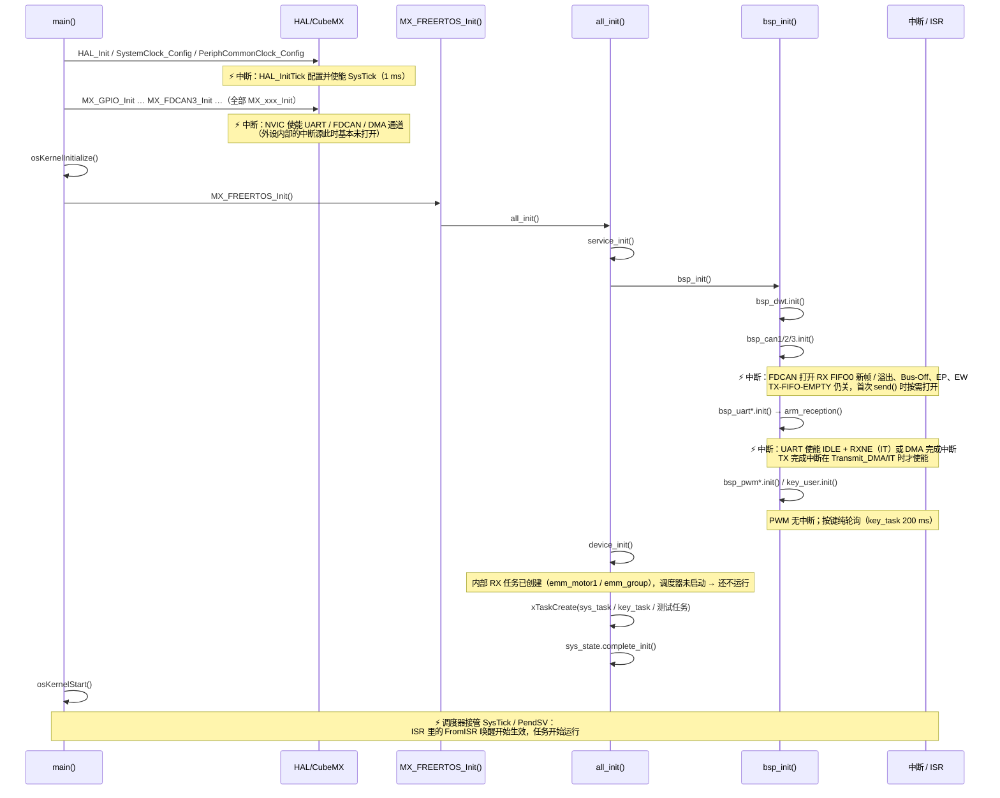

# bsp_cfg

> 代码：`bsp_cfg.hpp` / `bsp_cfg.cpp`

BSP 层的全局实例与统一初始化入口 `bsp_init()`。

## 实例归属

- **全部实例都定义在 `bsp_cfg.hpp`，是 C++17 inline 变量**（`inline BspUartT<...> bsp_uart1({...});`），
  `bsp_cfg.cpp` 里只剩 `bsp_init()`。
- 串口 / CAN 模板的显式实例化仍在 `bsp_uart.cpp`、`bsp_can.cpp`。
- DMA 串口实例用 `__attribute__((section(".dma_buffer.<变量名>")))`（该段落到 `RAM_D1`，
  DTCM 不能被 DMA 访问）。**段名必须按变量唯一**，原因见 `Docs/build/链接脚本改动.md`。

新增一个实例要同步两处：`bsp_cfg.hpp` 加一行定义 → `bsp_init()` 加一条
`configASSERT(... == Status::OK)`；串口/CAN 还要加显式实例化与回调分发表，见各模块 md。

### inline 变量对类的要求

- 构造函数必须 `constexpr` 且定义在头文件里，**析构必须平凡**（`~X() = default`）。
  否则实例退回动态初始化：实测每个包含 `bsp_cfg.hpp` 的 TU 都会生成约 1.7 KB 初始化代码
  （30 个 TU 合计多出 23 KB flash）。需要释放资源时显式调 `deinit()`。

## 模板实例化（全量）

| 文件 | 行 |
| --- | --- |
| `bsp_uart.cpp` | `template class BspUartT<uart_detail::DmaTransport, 128, 128>;` |
| `bsp_uart.cpp` | `template class BspUartT<uart_detail::DmaTransport, 256, 256>;` |
| `bsp_uart.cpp` | `template class BspUartT<uart_detail::ItTransport, 128, 32>;` |
| `bsp_uart.cpp` | `template class BspUartT<uart_detail::ItTransport, 128, 128>;` |
| `bsp_can.cpp` | `template class BspCanT<16, 16>;` |
| pwm / key / dwt / gpio | 非模板，无实例化 |

## 启动与初始化链

中断时序要点：

- `HAL_Init()` 使能 SysTick 后中断即可进入；此时任务尚未调度，ISR 里只能计数/搬字节。
- 外设中断源分两批打开：NVIC 通道在 `MX_xxx_Init()`，事件源（IDLE、RX FIFO0、DMA 完成）在
  `bsp_init()` 的 `init()` / `arm_reception()` / `ActivateNotification()` 里。
- `bsp_init()` 返回时 UART / CAN 接收中断已生效。
- `osKernelStart()` 之前进 ISR 没有任务可唤醒。

## 初始化约束

1. `all_init()` 在 `osKernelStart()` **之前**（`MX_FREERTOS_Init()` 内）：可建 StreamBuffer / Mutex /
   EventGroup / 任务，**不可**阻塞等待。
2. 每条 `init()` 用 `configASSERT(... == Status::OK)` 收口，失败关中断死循环；断点落在出问题的驱动上，
   所以 `bsp_init()` 无返回值。
3. 顺序：`bsp_dwt` 最先（其它驱动记时间戳）；`DeviceServo::init()` 读 `BspPwm::get_counter_clk_hz()`，
   PWM 必须在设备层之前。

## 上下文模型

| 接口 | 谁调 | 上下文 | 阻塞 |
| --- | --- | --- | --- |
| `BspUartT::send` / `receive` / `printf` | 任意任务 | 任务 | 可阻塞（默认 `portMAX_DELAY`） |
| `BspUartT::tx_recover` / `rx_recover` | `sys_task` | 任务 | 否（取锁等待 0） |
| `BspCanT::send` | 设备任务 | 任务 | 否 |
| `BspCanT::receive` | 单一消费者任务 | 任务 | 可阻塞 |
| `BspCanT::service_recovery` | `sys_task` | 任务 | 否（临界区） |
| `HAL_*_Callback` → `*_isr` | HAL | ISR | 否 |
| `BspPwm::*` | 设备层 | 任务 | 否（含浮点） |
| `BspKey::update` | `key_task` | 任务 | 否 |
| `BspDwt::get_delta_s` | 任意 | 任务 / ISR | 否 |
| `BspDwt::get_time_*` | 任意任务 | 任务 | 否（需 < 7.809 s 心跳） |

中断优先级统一 5（`configLIBRARY_MAX_SYSCALL_INTERRUPT_PRIORITY`），中断里可调 `...FromISR()`；
数值 0~4 的中断不被临界区屏蔽。

## 反模式

| 写法 | 后果 |
| --- | --- |
| ISR 里调 `HAL_UART_AbortReceive` / 恢复流程 | HAL 内部阻塞，卡死；只计数，恢复交给任务 |
| 两任务调同一总线 `receive()` | 帧被瓜分 |
| ISR 里解析协议 | 中断时间不可控，且需跨块状态 |
| `send()` 传 > `TX_SIZE` | `xStreamBufferSend` 永久阻塞（已被 `BAD_ARG` 拦） |
| DMA 缓冲放 DTCM | DMA1/2 访问不到，收不到数据且无报错 |
| `channel == 0` 判非法 | `TIM_CHANNEL_1 == 0`，误杀 CH1 |
| `HAL_GetTick()` 做 µs 级计时 | 分辨率 1 ms；用 `bsp_dwt` |
| `HAL_FDCAN_Stop()` 后立刻发控制帧 | 硬件 TX FIFO 未清，残留帧可能重发 |
