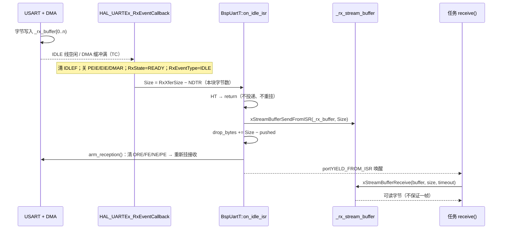
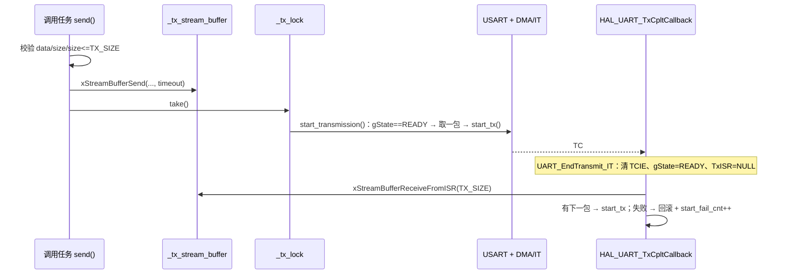

# bsp_uart

> 代码：`bsp_uart.hpp` / `bsp_uart.cpp`　实例：`bsp_cfg.cpp`

## 0. 如何快速完整的使用（不需要了解实际实现）

```cpp
// 1) 头文件：业务侧一般只需 bsp_cfg.hpp
#include "bsp_cfg.hpp"

// 2) 实例：bsp_cfg.cpp —— DMA 实例的缓冲区必须放 .dma_buffer
__attribute__((section(".dma_buffer")))
BspUartT<uart_detail::DmaTransport, 128, 128> bsp_uartX({&huartX, UartMode::TxRx, 115200U});

// 3) 声明：bsp_cfg.hpp
extern BspUartT<uart_detail::DmaTransport, 128, 128> bsp_uartX;

// 4) 显式实例化：bsp_uart.cpp 顶部（同类型已有则跳过）
template class BspUartT<uart_detail::DmaTransport, 128, 128>;

// 5) HAL 回调分发：bsp_uart.cpp 三张表各加一条
//    else if (huart == &huartX) { ... }

// 6) 初始化：bsp_cfg.cpp 的 bsp_init()
configASSERT(bsp_uartX.init() == Status::OK);

// 7) 周期恢复：sys_task.cpp —— DMA 实例进 patrol_uarts[]，IT 实例单独一行
(void)bsp_uartX.tx_recover();
(void)bsp_uartX.rx_recover();

// 8) CubeMX：外设 / 引脚 / DMA / NVIC 优先级 5
```

**调用示例**

```cpp
#include "bsp_cfg.hpp"

uint8_t tx[8] = {0x01, 0x02, 0x03, 0x04, 0x05, 0x06, 0x07, 0x08};
uint8_t rx[32];
size_t  got = 0;

(void)bsp_uartX.send(tx, sizeof(tx));       // 入流缓冲；默认等到全部入队
(void)bsp_uartX.send(tx, 4, 10);            // 最多等 10 ms
(void)bsp_uartX.printf("tick=%d\r\n", 42);  // 非阻塞

if (bsp_uartX.receive(rx, sizeof(rx), 10, &got) == Status::OK)
{
  // got 字节：可能是半帧，也可能多帧；切帧由上层负责
}
```

设备层把串口当模板参数，不 include `bsp_cfg.hpp`：

```cpp
DeviceEmmv5GroupT<decltype(bsp_uartX)> motor_group({bsp_uartX, {1, 2}});
motor_group.init();                     // 只建总线锁；之后由调用任务周期调 update()
motor_group.request_position(1);
int32_t pos = 0;
if (motor_group.get_position(1, pos)) { /* ... */ }
```

## 类型与配置

```cpp
template <typename Transport, size_t RX_SIZE, size_t TX_SIZE>
class BspUartT;
```

| 参数 | 含义 |
| --- | --- |
| `Transport` | `DmaTransport` / `ItTransport`，只封装启动收发、健康判据、已发字节数、中止通道 |
| `RX_SIZE` | 接收流缓冲 + `_rx_buffer[RX_SIZE]` |
| `TX_SIZE` | 发送流缓冲 + `_tx_buffer[TX_SIZE]` + `printf` 缓冲 |
| `Config{huart, mode, baudrate}` | `mode` = `RxOnly / TxOnly / TxRx`；`baudrate` 只用于 TX 卡死阈值，真实波特率在 CubeMX 的 `huartX.Init` |

`check_format()` 只回读 `huart->Init`，不改配置。

**接口约定**

- `send(data, size, timeout, written)` 与 `receive(buffer, size, timeout, received)`：**timeout 都在倒数第二**，
  结果指针最后、可传 `nullptr`。
- `send()` 单次不超过 `TX_SIZE`，超了返回 `BAD_ARG`；要发长数据自己分段。
- 返回 `OK` 只表示入队，不代表已上线。
- 多任务可同时 `send()` / `printf()`；`receive()` 只能有一个消费者。
- 初始化已在 `bsp_init()` 完成，业务代码只调收发。

## 接收链（DMA / IT 相同）



**HAL 进回调前做了什么**

| 事件 | HAL 的动作 | 回调参数 |
| --- | --- | --- |
| IDLE（DMA 普通模式） | 清 `IDLEF`；`RxXferCount = NDTR`；关 `PEIE`/`EIE`/`DMAR`；`RxState = READY`；`ReceptionType = STANDARD`；关 `IDLEIE`；`HAL_DMA_Abort()` | `Size = RxXferSize − RxXferCount` |
| IDLE（IT / FIFO） | 清 `IDLEF`；关 `RXNEIE`/`PEIE`/`EIE`（FIFO 另关 `RXFTIE`）；`RxState = READY`；`RxISR = NULL`；关 `IDLEIE` | `Size = RxXferSize − RxXferCount` |
| TC（DMA 缓冲满） | `RxEventType = TC` | `Size = RxXferSize`（整块） |
| HT（DMA 半传） | `RxEventType = HT`，DMA 仍在跑 | `Size = RxXferSize / 2` |

- 进 `on_idle_isr` 时 DMA/IT 已停、`RxState` 已 READY，`_rx_buffer[0..Size)` 就是本块数据，可直接投递并重新 arm。
- **HT 不是帧边界**：DMA 还在同一块缓冲里写，投递会重复且破坏数据，必须丢弃。

**`on_idle_isr()` 内部逐步**

```cpp
if (_huart == nullptr || !_rx_enabled()) return;          // 未初始化 / 只发模式
if (_huart->RxEventType == HAL_UART_RXEVENT_HT) return;  // 半传不是帧边界

size_t pushed = xStreamBufferSendFromISR(_rx_stream_buffer, _rx_buffer, size, woken);
_rx_drop_bytes += (size - pushed);                       // 流缓冲满只丢尾部

(void)arm_reception();                                    // 清 UART 错误标志 → 重新挂接收
```

1. 投递的是 `_rx_buffer` 的**前 `Size` 字节**。
2. `SendFromISR` 只写入能放下的部分，剩余计入 `drop_bytes`。
3. `arm_reception()` 失败只 `arm_fail_cnt++`，不在中断重试（HAL Abort 阻塞）；`sys_task` 的
   `rx_recover()` 10 ms 内用 `get_rx_health()` 发现并重建。
4. 回调返回后 `portYIELD_FROM_ISR(woken)` 唤醒任务。
5. ISR 只搬字节，不切帧、不解析协议。

`arm_reception()` 先清 `PEF/FEF/NEF/OREF`（有挂起错误时 HAL 拒绝启动）；DMA 的 TC/HT/TE/FE/DME 由
`HAL_DMA_Abort()` 用 IFCR 一次清完 6 个。
`abort_reception()` = `Transport::abort_rx()` + 清 `CR1.IDLEIE`，只动 RX。

## 发送链



**HAL 进回调前做了什么**（`UART_EndTransmit_IT`）：清 `CR1.TCIE` → `gState = READY` → `TxISR = NULL`
→ 调 `HAL_UART_TxCpltCallback(huart)`。所以回调里通道一定空闲，**不需要 `_tx_lock`**。

**`start_transmission_from_isr()` 内部逐步**

```cpp
if (_huart == nullptr || _tx_stream_buffer == nullptr || !_tx_enabled()) return;
if (_huart->gState != HAL_UART_STATE_READY) { _tx_isr_skip_cnt++; return; } // 数据留在缓冲

size_t n = xStreamBufferReceiveFromISR(_tx_stream_buffer, _tx_buffer, TX_SIZE, woken);
if (n == 0U) { _tx_inflight_len = 0; return; }                 // 上一批已发完，无新数据

if (!Transport::start_tx(_huart, _tx_buffer, n)) {             // 启动失败
  (void)xStreamBufferSendFromISR(_tx_stream_buffer, _tx_buffer, n, woken); // 回滚
  _tx_inflight_len = 0;
  _tx_start_fail_cnt++;
} else {
  _tx_last_activity_tick = xTaskGetTickCountFromISR();         // 供 tx_recover 判卡死
  _tx_inflight_len = n;
}
```

1. `gState != READY`：不取数据，记 `isr_skip_cnt`，等 `tx_recover()` 下个周期重发。
2. 一次最多取 `TX_SIZE` 字节；`_tx_inflight_len` = 已交出、未确认发完的长度。
3. 启动失败回滚进流缓冲（刚取 `n` 字节，必然放得下）。
4. 每包发完进一次本回调；流缓冲为空只清 `_tx_inflight_len`。

任务侧 `_tx_lock` 保护 `_tx_buffer` 与「判忙 → 取包 → 启动」三步，防止两个任务同时写 DMA 正在读的缓冲。
ISR 只在 TC 回调里取包；TC 期间 HAL 已交还通道，任务不能运行，两端不会并发。

**`on_error_isr()`**：`gState != READY` → `_tx_error_cnt++`；`ErrorCode` 含 `PE|NE|FE|ORE|RTO` →
`_rx_hw_error_cnt++`。只计数，恢复交给任务侧的 `tx_recover()` / `rx_recover()`。

## 诊断与恢复

| 计数 | 位置 | 含义 |
| --- | --- | --- |
| `arm_fail_cnt` | `RxDiag` | 启动接收失败次数（含 init）；正常 0 |
| `drop_bytes` | `RxDiag` | 流缓冲满丢掉的字节 |
| `hw_error_cnt` | `RxDiag` | PE / NE / FE / ORE / RTO 次数 |
| `error_cnt` | `RxDiag` | `rx_recover()` 重建 RX 的次数 |
| `drop_bytes` | `TxDiag` | 入队失败丢掉的字节 |
| `start_fail_cnt` | `TxDiag` | 启动发送失败次数（任务 + ISR） |
| `isr_skip_cnt` | `TxDiag` | 中断里通道不空闲、跳过续传 |
| `stall_recover_cnt` | `TxDiag` | 巡检恢复成功次数 |
| `error_cnt` | `TxDiag` | TX 进错误回调次数 |

- `tx_recover()`：有在途或有排队，且闲置 ≥ `TX_SIZE × 20 × 1000 / baudrate` ms（一包 10 bit/字节 × 2）；
  用 `Transport::tx_sent()` 算已发量，`abort_tx()` 后只补剩余。
- `rx_recover()`：`_rx_should_run == false` 不算故障；`get_rx_health() == OK` 直接返回；否则
  `abort_reception()` + `arm_reception()`。
- `_rx_should_run` = **期望**在收，失败不永久置假。

健康判据（`OK / STOPPED / INCONSISTENT`）：

| Transport | `rx_ok()` |
| --- | --- |
| DMA | `RxState == BUSY_RX` 且 `CR3.DMAR == 1` 且 `DMA_SxCR.EN == 1` |
| IT | `RxState == BUSY_RX` 且（`RXNEIE` + `IDLEIE`，或 FIFO 模式 `CR3.RXFTIE` + `IDLEIE`） |

IT 两种都要认：HAL 在 `FIFOMODE_ENABLE` 且长度 ≥ 阈值时走 `UART_RxISR_8BIT_FIFOEN`，只开 `RXFTIE`；
小于阈值可能退回逐字节 `RXNEIE`。

## 新增一路串口

**CubeMX**

| 参数 | 位置 | 取值 / 说明 |
| --- | --- | --- |
| 引脚 / 复用 | Pinout → USARTx | TX/RX 选 AF；RS485 另选 DE |
| 波特率 / 字长 / 校验 / 停止位 | Parameter Settings | 常用 8N1；SBUS = 100000 / 9B / Even / 2（9B 含校验位） |
| 收发方向 | Mode | Asynchronous / Rx Only |
| DMA | DMA Settings | DMA 实例配 RX + TX 两条流；IT 不配 |
| 中断 | NVIC | USARTx 全局中断，优先级 **5**（`configLIBRARY_MAX_SYSCALL_INTERRUPT_PRIORITY`） |
| RS485 | Advanced Features | Hardware DE → `HAL_RS485Ex_Init()` |

**模板参数**

| 选择 | 怎么改 | 代价 / 约束 |
| --- | --- | --- |
| DMA / IT | 第一个参数 | DMA 要配流、实例放 `RAM_D1`；IT 省 DMA，高波特率 CPU 负担大 |
| `RX_SIZE` | 第二个 | 接收流缓冲 + 暂存区各 `RX_SIZE` |
| `TX_SIZE` | 第三个 | 发送流缓冲 + 暂存区 + `printf` 各 `TX_SIZE`；`send()` 单次上限 |
| RAM 粗算 | — | `RX_SIZE + 2 × TX_SIZE`，另加控制块与两把锁 |
| `mode` | `Config` | `TxRx` / `RxOnly` / `TxOnly` |
| `baudrate` | `Config` | 只算 TX 卡死阈值，**必须等于** `huartX.Init.BaudRate` |

`static_assert`：`1 ≤ RX_SIZE/TX_SIZE ≤ 65535`（HAL 长度是 `uint16_t`）。

**四处同步**

1. `bsp_uart.cpp` 顶部显式实例化（同类型已有则跳过）。
2. 三张分发表各加 `else if (huart == &huartX)`——漏一条 = 能收不能发 / 出错不计数。
3. `bsp_cfg.hpp` `extern` + `bsp_cfg.cpp` 实例（DMA 加 `.dma_buffer`）+ `bsp_init()` 的 `configASSERT`。
4. `sys_task.cpp` 巡检：DMA 进 `patrol_uarts[]`，IT 单独一行。

**示例：UART6，921600 8N1，DMA，128/128**

```cpp
__attribute__((section(".dma_buffer")))
BspUartT<uart_detail::DmaTransport, 128, 128> bsp_uart6({&huart6, UartMode::TxRx, 921600U});
```

**确认**：测试里调 `check_format(921600U, UART_WORDLENGTH_8B, UART_PARITY_NONE, UART_STOPBITS_1)`，
false = CubeMX 与 `Config` 有一边错。
