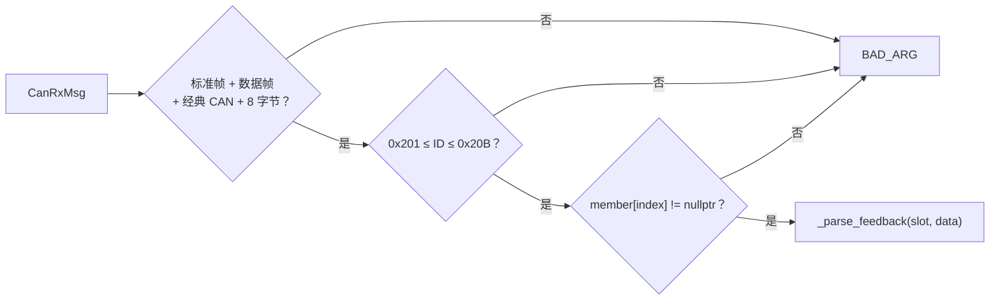
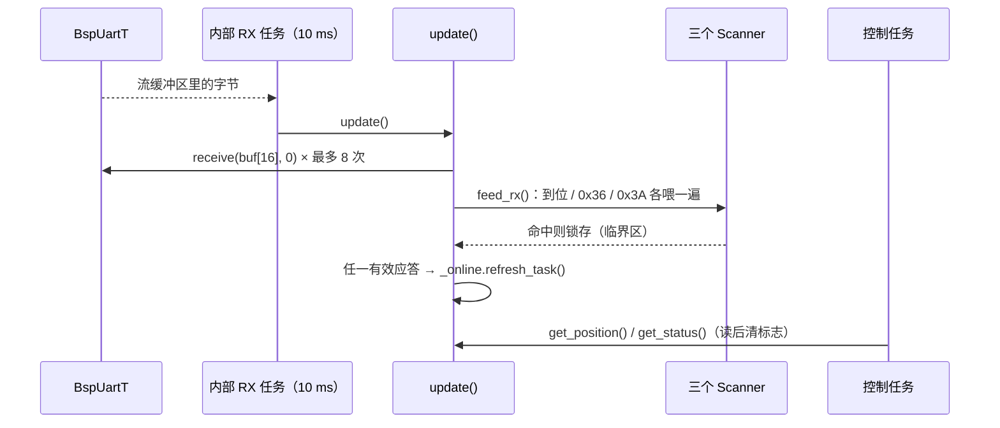

# Device 层手册

> 代码：`User/Device/`　只依赖 Bsp（及 Protocol / Service 的纯工具）。
> 引脚：[引脚分配与冲突](../../Docs/hardware/引脚分配与冲突.md)　EmmV5 阅读：[emmv5与uart阅读顺序](../../Docs/guide/emmv5与uart阅读顺序.md)

## 1. 定位与边界

Device 把帧 / 字节 / 占空比换成物理量，或把物理量换成协议帧。一个实例 = 一台设备（或一条总线上的设备组）。

| 可以放进来                               | 不能放进来                                     |
| ---------------------------------------- | ---------------------------------------------- |
| 协议帧的解析与组装、单位换算、限幅       | 外设寄存器、HAL 调用、中断回调                 |
| 设备级配置（地址、减速比、零位、通道号） | 全局状态登记（`sys_state` / `EventState`） |
| 在线判定节点、内部接收任务（确有需要时） | 业务决策（是否停车、走哪条路线）               |
| 返回 `Status` 给调用方                 | 吞掉错误、自己把整机置为失败                   |

**硬规则**

1. 设备**不引用** `sys_state` / `EventState`：失败只 `return Status`，聚合由 `device_init()` 做。
2. 设备**不拥有** BSP 资源，只持引用 / 指针（`BspCan*`、`BspUart&`、`BspPwm*`）。
3. 一条总线 / 一路串口**只能有一个接收消费者**：`DeviceEmmv5*` 由内部 RX 任务占据，
   `DjiMotorGroupT` / `DeviceR9dsT` 由外部任务占据。
4. 对象**不可复制**：`Online` 节点靠地址挂链表，复制会让链表指向原对象。

## 2. 三种驱动骨架

### 3.1 外部任务驱动（DJI / R9DS）

```cpp
// 同一个任务里，按顺序做；不要拆到两个任务
CanRxMsg rx = {};
for (uint32_t i = 0; i < 8 && bsp_can3.receive(&rx, 0) == Status::OK; ++i)
  (void)can3_dji_group.update(rx);     // 收 + 解

(void)can3_dji_group.set_output(4, 5000); // 算（只写发送缓冲）
(void)can3_dji_group.poll();              // 发（有成员的帧才发）

const MotorData &md = can3_dji_group.get_data(4);
```

### 3.2 内部 RX 任务（EmmV5 单机 / 多机）

```cpp
// 业务任务：只发命令、取结果
(void)emm_motor1.request_position();
int32_t pos = 0;
if (emm_motor1.get_position(pos)) { /* 新值 */ }
```

`init()` 里 `xTaskCreate(_rx_task_entry, ..., this, tskIDLE_PRIORITY + 6, ...)`，任务体每 10 ms 调私有 `update()`。
业务任务再调 `update()` 就是第二个消费者。

### 3.3 单写者（Servo）

```cpp
// 任务 A（周期）：唯一的 PWM 写入者
servo.update();

// 任意任务：只写“目标 + 要输出”两个 32 位变量
servo.set_angle(120.0f);
```

## 4. `DjiMotorGroupT`：位置推出一切

### 4.1 为什么是 11 个固定位置

DJI 电调反馈标识符连续：C620/C610 = `0x200 + ID`（ID 1~8 → 0x201~0x208），GM6020 = `0x204 + ID`
（ID 1~7 → 0x205~0x20B）。所以 0x201~0x20B 唯一对应 11 个位置，**位置 = 标识符 − 0x201**，接收侧不查表。

| 位置 | 反馈标识符  | 允许型号               | 控制帧                             | 帧内槽位  |
| ---- | ----------- | ---------------------- | ---------------------------------- | --------- |
| 0~3  | 0x201~0x204 | M3508 / M2006          | 0x200                              | 位置      |
| 4~7  | 0x205~0x208 | M3508 / M2006 / GM6020 | 0x1FF（3508/2006）或 0x1FE（6020） | 位置 − 4 |
| 8~10 | 0x209~0x20B | 仅 GM6020              | 0x2FE                              | 位置 − 8 |

**电调 ID ≠ 位置**，装车前必须按上表在 RoboMaster Assistant 里设 ID：

| 位置 | 型号        | 电调 ID | 控制帧 | 槽位      |
| ---- | ----------- | ------- | ------ | --------- |
| 0~3  | M3508/M2006 | 1~4     | 0x200  | 位置      |
| 4~7  | M3508/M2006 | 5~8     | 0x1FF  | 位置 − 4 |
| 4~7  | GM6020      | 1~4     | 0x1FE  | 位置 − 4 |
| 8~10 | GM6020      | 5~7     | 0x2FE  | 位置 − 8 |

位置 4~7 能混挂的原因：0x205~0x208 被两类共用，靠**控制帧**区分；接收侧零额外判断。

当前台架配置（`device_cfg.cpp`）：位置 4（0x205，GM6020 电调 ID 1，控制帧 0x1FE 槽 0）与
位置 9（0x20A，GM6020 电调 ID 6，控制帧 0x2FE 槽 1）。空位必须写 `nullptr` 占位，
**少写一个后面的位置全部错一位**。

### 4.2 型号常量

| 型号   | 原始指令上限 | 默认减速比 | 说明                                             |
| ------ | ------------ | ---------- | ------------------------------------------------ |
| M3508  | ±16384      | 3591/187   | C620                                             |
| M2006  | ±10000      | 36         | C610                                             |
| GM6020 | ±16384      | 1          | 只支持电流模式，固件 ≥ 1.0.11.2，且需打开电流环 |

`Member{model, ratio, offset}`：`ratio` 传 0 表示用型号默认值；`offset` 是机械零位（rad）。

### 4.3 `init()`：把配置折叠进 Slot

对 11 个位置从左到右扫一遍：空位跳过；型号与位置不相容 → `BAD_ARG`；否则把
`limit / data.param.offset / data.param.ratio / tx_frame / tx_slot` 一次算好写进 `Slot`，
并置 `_frame_active[frame] = true`。之后的热路径（`update` / `set_output` / `poll`）**完全不看型号**。

### 4.4 `update()`：一帧反馈的完整解析链



`_parse_feedback()` 的换算（`ratio` = 减速比，`offset` = 零位）：

```
DATA[0:2]  ecd   = 大端 uint16，范围 0~8191（>= 8192 视为脏帧 → BAD_ARG）
DATA[2:4]  rpm   = 大端 int16，**转子转速**
DATA[4:6]  实际转矩电流（不用）
DATA[6]    温度（不用）

velocity  = rpm / ratio × π/30                       → rad/s（输出轴）
total_ecd = unwrap_ecd(total_ecd, last_ecd, ecd, 8192) → 跨零展开后的累计转子计数
rotor_ang = total_ecd × 2π / 8192                    → rad（转子）
out_ang   = (rotor_ang − offset) / ratio              → rad（输出轴）
angle_multi_round  = out_ang                          （double，不压回 float）
angle_single_round = fmod(out_ang, 2π)，负数补一圈      → [0, 2π)
```

跨零展开的判据是「相邻两帧位移必然小于半圈」（`half = 4096`）：

```
正转跨零：last=8000, now=200  → delta=-7800 < -4096 → +8192 →  392
反转跨零：last=200,  now=8000 → delta=+7800 > +4096 → -8192 → -392
正常前进：last=1000, now=1100 → delta= 100        → 不变
```

首帧 `total_ecd = ecd`，所以上电后累计角度从 0 附近起算。解析成功才 `feedback_ready = true`
并 `online.refresh_task()`；`radian_data.acceleration` **本类不填，恒为 0**（跨帧量，留给上层）。

### 4.5 `set_output()` 与 `poll()`

- `set_output(index, raw)`：`raw` 限幅到 `±slot.limit`，按大端写进
  `_frame_data[slot.tx_frame][slot.tx_slot × 2]`。**只写缓冲，不发送**；反复调用是覆盖，不累加。
- `poll()`：依次发送 `0x200 / 0x1FF / 0x1FE / 0x2FE`，`_frame_active[frame] == false` 的整条跳过。
  单次发送失败不上报，查 `BspCan::diagnostics.tx_buf_full / tx_dropped`。
- 没被写过的槽位一直是 0（构造时清零），等价于该路 0 输出。

### 4.6 线程模型

- 本类**不是线程安全的**：约定同一个任务依次 `update() → set_output() → poll()`，内部无锁。
- `get_data()` 返回 `Slot::data` 的**实时引用**，读期间不得并发 `update()`；越界或无电机返回静态全零对象。
- 在线判定用 `Slot::online`（阈值 30 ms），计时由 `sys_task` 每 10 ms 推一次，与本任务调用频率无关。

## 5. `DeviceEmmv5T`：单串口单电机

### 5.1 接收链



- `update()` 非阻塞：每次最多 `8 块 × 16 字节`，数据持续到达时也会把 CPU 让出去。
- 到位帧 `addr FD 9F 6B`、位置应答 `addr 36 sign v3..v0 6B`、状态应答 `addr 3A status 6B`，
  三类分别由协议层的三个扫描器跨块拼帧。
- `get_position()` / `get_status()` 在短临界区里**一起**拷贝值与有效标志并清标志，可从其他任务调用。
- `is_online()` 用 `Online` 节点（100 ms）：任意一类有效应答都会续命。查询周期应 < 100 ms，
  否则“没被问”也会显示离线。

### 5.2 发送链

`enable / set_velocity / set_position / set_quick_* / stop / zero_position / read` 都是
「校验参数 → 协议层拼帧 → `_send()`」：

- `_send()` 先检查 `frame.valid()`（未封口 / 溢出 → `BAD_ARG`），再 `uart.send(..., 20 ms)`。
  20 ms 内进不去就返回 `TIMEOUT`，不无限挂住控制任务。
- `read()` 只解析 `CurrentPosition`（0x36）与 `StatusFlag`（0x3A）；其它参数的应答被丢弃。
- `set_velocity` / `set_position` 会校验 `rpm ≤ 5000` 与方向枚举，其它命令只校验帧有效性。

### 5.3 使用约束

- 地址 1~255；`0` 是广播地址，用作实例会 `BAD_ARG`（会把别人的到位帧算成自己的）。
- 内部 RX 任务是本路串口唯一的接收消费者，业务层**不要**直接调 `update()`、不要直接读 `BspUart`。
- 对象必须是全局/静态生命周期；不要在 RX 任务里销毁它。

## 6. `DeviceEmmv5GroupT`：单串口多电机 + MMCL

### 6.1 地址表

`Config{Uart&, std::initializer_list<uint8_t> addrs}`，最多 8 台。`init()` 校验：地址数 1~8、
地址非 0、地址不重复。每个电机有独立的三个扫描器 + 一个 `Online` 节点。

### 6.2 按地址分发

`update()` 读到的每块字节会交给**组内每一台**电机的扫描器各喂一遍，归属由扫描器内部的
「地址 + 功能码」条件决定。所以设备层不写任何协议解析，也不需要按地址拆分字节流。

### 6.3 MMCL 多机总帧

```
总帧 = target(1) + 0xAA(1) + 总长度(2, 大端，含头尾 5 字节) + 子命令串(N) + 0x6B(1)
子命令 = 各自地址 + 功能码 + 数据 + 0x6B（就是普通命令帧）
```

- 缓冲 `_multi[128]` 与串口发送流缓冲区同大小；前 4 字节给总帧头，所以
  **子命令总字节上限 = 128 − 5 = 123**（`MULTI_PAYLOAD_MAX`）。
- `_queue_for()` 先判断整帧放得下再拷贝，放不下返回 `FULL`，**绝不留下半条子命令**。
- `multi_send()` 用 `build_multi_frame()` 就地把总帧封进 `_multi`（`payload` 与 `out` 重叠，必须 `memmove`），
  发送后**无论成败都清空缓冲**：超时可能已有一半字节进了流缓冲，重发会出现“半帧 + 完整帧”。
- `multi_clear() / queue_*() / multi_send()` 必须由**同一个任务**串行调用，否则子命令会互相拼接。

### 6.4 结果接口

| 接口                        | 语义                                                   |
| --------------------------- | ------------------------------------------------------ |
| `get_in_position()`       | 返回累计到位位图（bit i = 下标 i），**读后清零** |
| `in_position(index)`      | 只查询，不清零                                         |
| `get_position(addr, out)` | 取走 0x36 最近值，读后清有效标志                       |
| `get_status(addr, out)`   | 取走 0x3A 状态字节，读后清有效标志                     |
| `is_online(addr)`         | 100 ms 内有过有效应答                                  |

到位标志、位置、状态的“写 / 读 / 清零”都用同一个短临界区，避免接收任务与控制任务竞争。

## 7. `DeviceServo`：梯形规划与单写者

### 7.1 换算链

```
t      = angle / range_deg
t      = reversed ? 1 − t : t
pulse  = pulse_min_us + t × (pulse_max_us − pulse_min_us) + trim_us
```

算例：`range_deg = 180`、`500 ~ 2500 µs` → 90° → `t = 0.5` → 1500 µs。

### 7.2 `update()` 的四步

1. 没有「要输出」请求 → `pwm->off()`（只在还亮着时写一次寄存器），返回。
2. 首次生效的那一拍**只登记**、不积分（避免长时间没更新后第一拍跳变）。
3. `max_speed_dps == 0`（不限速）→ 直接把 `_angle_deg` 落到目标并写脉宽。
4. 否则梯形规划：
   - `dt = tick 差值 / configTICK_RATE_HZ`，**上限 `MAX_DT_S = 0.1 s`**（任务卡住后不补一大段角度）。
   - `v_cmd = ±v_max`（由剩余角度符号决定）。
   - 加速度限制：`|Δv| ≤ a·dt`；制动距离限制：`|v| ≤ sqrt(2·a·|rem|)`。
     这保证“现在开始匀减速，恰好在目标点停下”。
   - `step = v·dt`；`|step| ≥ |rem|` 时直接落位并把速度清零（留非零速度会让下一拍反向抖）。

### 7.3 线程模型

| 接口               | 谁调                     | 原因                                                                   |
| ------------------ | ------------------------ | ---------------------------------------------------------------------- |
| `update()`       | 固定一个任务、周期调用   | 唯一的 PWM 写入者；不调就没有输出，`off()` 也不生效                  |
| `set_pulse_us()` | 须与 `update()` 同任务 | 要立即接管输出，无法用“下一拍”表达                                   |
| `set_angle()`    | 任意任务                 | 只写 `_target_deg` + `_enabled_req` 两个 32 位变量（单条 `STR`） |
| `off()`          | 任意任务                 | 只清 `_enabled_req`，真正关断在下一拍                                |
| `get_*()`        | 任意任务                 | 32 位对齐读，可能比 `update()` 晚一拍                                |

成立前提：Cortex-M7 单核、32 位对齐读写是单条指令、D-Cache 未开。

### 7.4 开环器件

写出去的是“希望它到哪”，不是“它真的在哪”。堵转、限矩、掉电都发现不了，所以**不注册 `Online`**。
`init()` 只校验配置，不写脉宽（上电不输出）；脉宽端点、限速、加速度都是待实机标定的占位值。

## 8. `DeviceR9dsT`：SBUS 逐字节同步

- 物理层：100000 bps、8 数据位 + 偶校验 + 2 停止位（每字节 12 位）、**反相 TTL**。
- 帧：`0x0F` + 22 字节（16 通道 × 11 bit，小端）+ flags + `0x00`，共 25 字节。
- `init()` 用 `uart.check_format(100000, WORDLENGTH_9B, PARITY_EVEN, STOPBITS_2)` 兜底校验；
  不一致返回 `BAD_ARG`（本类不改串口配置）。
- `update()` 逐字节推进状态机：找 `0x0F` → 拼满 25 字节 → 验帧尾 `0x00`（否则 `bad_footer_cnt++`）。
  逐字节读而不是一次读 25 字节：`receive()` 只保证有多少给多少，凑不满反而把帧切歪。
- 通道提取用统一下标循环：`bit = i × 11`，`byte = bit / 8 + 1`，`shift = bit % 8`，
  `(frame[byte] | frame[byte+1] << 8 | frame[byte+2] << 16) >> shift & 0x7FF`。
- 两套量：`raw_channels()` 是协议原始值（上 200 / 中 1000 / 下 1800）；`rc()` 是遥控器语义值
  （连续通道 −100 ~ +100，`RAW_PER_UNIT = 8`；整数截断使 raw 993~1007 都算 0）。
- 开关按「离 200 / 1000 / 1800 哪个最近」判挡；两挡开关只比 200 / 1800。
- 在线 = ① 收到过帧且 100 ms 内有新帧 ② `!failsafe` ③ `lost_streak < 5`。
  单独判 `frame_cnt` 是因为**遥控器关机时接收机照发帧**，只看“有没有帧”会一直显示在线；
  而实测 `lost` 比 `fs` 先置位，所以用连续 lost 当提前量（约 40 ms）。
- 不是线程安全：`update()` 只允许一个任务调；`rc()` 返回实时引用。

| 通道 | 物理部件    | 类型 | `Rc` 字段          |
| ---- | ----------- | ---- | -------------------- |
| CH1  | 右摇杆 上下 | 连续 | `right_vertical`   |
| CH2  | 右摇杆 左右 | 连续 | `right_horizontal` |
| CH3  | 左摇杆 上下 | 连续 | `left_vertical`    |
| CH4  | 左摇杆 左右 | 连续 | `left_horizontal`  |
| CH5  | C 三挡开关  | 三挡 | `switch_c`         |
| CH6  | 正面左旋钮  | 连续 | `knob_left`        |
| CH7  | 背面左推杆  | 连续 | `slider_left`      |
| CH8  | 正面右旋钮  | 连续 | `knob_right`       |
| CH9  | 正面 B 开关 | 两挡 | `switch_b`         |
| CH10 | 正面 A 开关 | 两挡 | `switch_a`         |

诊断（`get_diag()`）用来区分两种“收不到”：`byte_cnt == 0` → 接线 / 波特率 / 反相；
`byte_cnt` 在涨而 `frame_cnt` 不动 → 帧格式或反相有问题。

**调用示例**（外部任务驱动，本类不加锁）

```cpp
r9ds.update();                                  // 把串口里攒的字节全部消化
if (r9ds.is_online() && !r9ds.failsafe())
{
  const auto &rc = r9ds.rc();                   // 遥控器语义值
  const float fwd  = rc.left_vertical * 0.01f;  // -1.0 ~ +1.0
  const bool  a_up = (rc.switch_a == decltype(r9ds)::Switch::UP);

  const uint16_t *raw = r9ds.raw_channels();    // 需要协议原始值时用这个
  (void)fwd; (void)a_up; (void)raw;
}
```

## 9. `DeviceBuzzer`

- 音调 = PWM 频率（`set_freq`），音量 = 占空比。
- `tone()` 非阻塞；`beep()` = `tone()` + `vTaskDelay()` + `off()`，**阻塞**。
- 所以 `beep()` 不能与「严格等周期轮询」放在同一个任务里（`key_task` 的周期会多出一个响铃时长）。
- 没有 `init()`：PWM 由 `bsp_init()` 启动，构造时只保存引用与配置。

## 10. `device_init()` 的顺序与断言

```cpp
void device_init(void)
{
  configASSERT(can3_dji_group.init() == Status::OK);
  configASSERT(r9ds.init() == Status::OK);
  configASSERT(emm_motor1.init() == Status::OK);
  configASSERT(emm_group.init() == Status::OK);
  configASSERT(servo1.init() == Status::OK); // …servo4
}
```

- 必须在 `bsp_init()` 之后：所有设备都拿 BSP 实例的引用；`DeviceServo::init()` 还要读 PWM 的计数器时钟。
- 每个 `init()` 自己校验、自己 `configASSERT` 由调用点负责；任一失败就地停机。
- `buzzer` 没有 `init()`，不需要在这里出现。

## 11. 新增一台设备

1. 在 `User/Device/` 建 `device_xxx.hpp/.cpp`，类内参数收进 `Config`（字段 < 4 个可不建 `Config`）。
2. 若用模板（串口 / 总线类型可变），在 `.cpp` 顶部写**显式实例化**，覆盖 `device_cfg.cpp` 用到的类型：
   `template class DeviceXxxT<BspUartT<uart_detail::DmaTransport, 128, 128>>;`
   漏写会在链接时报「undefined reference to 成员函数」。
3. `device_cfg.hpp` 加 `extern`（模板类型用 `decltype(bsp_xxx)`），`device_cfg.cpp` 加实例与
   `device_init()` 里的一行 `configASSERT`。
4. 需要测试：`User/App/test/<模块>/xxx_test.cpp` + `app_test.hpp` 开关 + `api_main.cpp` 里的
   `#if` 创建块（新增文件不用改 CMake，`GLOB_RECURSE` 会自动收集）。
5. 需要周期调用 `update()` 的，明确写清由谁调：外部任务（并在 `app_task.hpp` 声明任务）
   或类内自建任务（并在文档与注释里写明周期与优先级）。

### 11.1 参数怎么填（按设备）

| 设备       | 参数                                                               | 位置                                                    | 取值 / 约束                                                                                                                            |
| ---------- | ------------------------------------------------------------------ | ------------------------------------------------------- | -------------------------------------------------------------------------------------------------------------------------------------- |
| DJI 电机组 | `Member{model, ratio, offset}`                                   | `device_cfg.cpp` 的文件级静态常量                     | 实参顺序 = 位置 0~10（0x201~0x20B）；空位 `nullptr`；`ratio = 0` 用型号默认（3508 3591/187、2006 36、6020 1）；`offset` 单位 rad |
| DJI 电机组 | 指令限幅                                                           | `MODEL_TRAITS`（`dji_motor_group.cpp`）             | 手册值 16384 / 10000 / 16384；改型号必须同步这张表与 `MODEL_NUM`                                                                     |
| EmmV5 单机 | 地址                                                               | `Config{uart, addr}`                                  | 1~255；0 是广播地址，不能当实例                                                                                                        |
| EmmV5 多机 | 地址表                                                             | `Config{uart, {a, b, …}}`                            | 1~8 个；不能重复、不能为 0                                                                                                             |
| EmmV5 全部 | 串口波特率                                                         | CubeMX `huartX.Init.BaudRate` + 电机菜单 `UartBaud` | 两边必须一致（UART7 = 921600，USART2 = 115200）                                                                                        |
| R9DS       | 串口格式                                                           | CubeMX `huart5`                                       | 100000 / 9B / Even / 2；接收机拨到 SBUS；硬件反相                                                                                      |
| R9DS       | 在线阈值                                                           | `ONLINE_TIMEOUT_MS` / `LOST_STREAK_TO_OFFLINE`      | 100 ms / 5 帧；调大趋稳、调小更早报失联                                                                                                |
| 舵机       | `pulse_min_us` / `pulse_max_us` / `range_deg`                | `device_cfg.cpp`                                      | 按手上舵机实测标定；`pulse_max + trim` 必须小于 PWM 周期（20 ms）                                                                    |
| 舵机       | `max_speed_dps` / `max_accel_dps2`                             | 同上                                                    | 0 = 不限速；两者共同决定走满行程的时间                                                                                                 |
| 舵机       | `reversed` / `trim_us`                                         | 同上                                                    | 装反用 `reversed`；机械中位偏差用 `trim_us` 补                                                                                     |
| 蜂鸣器     | `Config{default_freq, freq_min, freq_max, short_ms, volume_pct}` | `DeviceBuzzer` 构造（当前用默认值）                   | 无源蜂鸣器 50~20000 Hz；音量 = 占空比                                                                                                  |

**换绑串口 / 总线**：改实例的模板实参类型（`decltype(bsp_uartX)` / `decltype(bsp_canX)`）→
在设备 `.cpp` 顶部补对应的显式实例化 → 改 `device_cfg.cpp` 的构造参数。
三处类型必须完全一致，否则链接期报找不到成员函数。

**改反馈解析**：协议字段来源写在 `_parse_feedback()`（DJI）或扫描器（EmmV5）；
改换算系数前先确认单位（rpm / rad/s、counts / rad），别把转子量与输出轴量混用。

## 12. 反模式

| 写法                                              | 后果                                                  |
| ------------------------------------------------- | ----------------------------------------------------- |
| 设备里写 `sys_state` / `EventState`           | 单个设备失败会拖停整机，任务全卡在 `wait_running()` |
| 业务任务再调 `DeviceEmmv5*::update()`           | 内部 RX 任务被抢字节，帧被切坏                        |
| 两个任务共用一条串口/总线接收                     | 帧被瓜分，两边都不完整                                |
| MMCL 在多个任务里 `queue_*`                     | 子命令互相拼接，发出错误的复合命令                    |
| 把 `get_data()` / `rc()` 的引用存起来跨周期用 | 引用指向内部缓冲，下一拍就被改写                      |
| 复制设备对象                                      | `Online` 链表节点地址变化，析构时链表错乱           |
| 假设舵机有位置反馈                                | 开环器件无从判断是否到位                              |
| 在周期任务里调 `beep()`                         | 阻塞 `vTaskDelay`，周期被拉长                       |

## 13. 与代码注释的分工

- 代码里保留：`@brief`、单位 / 范围 / 前置条件、就地的“为什么不能这样写”。
- 本文覆盖：位置-ID 对照表、解析公式与算例、线程模型表、MMCL 上限算术、新增设备清单。
