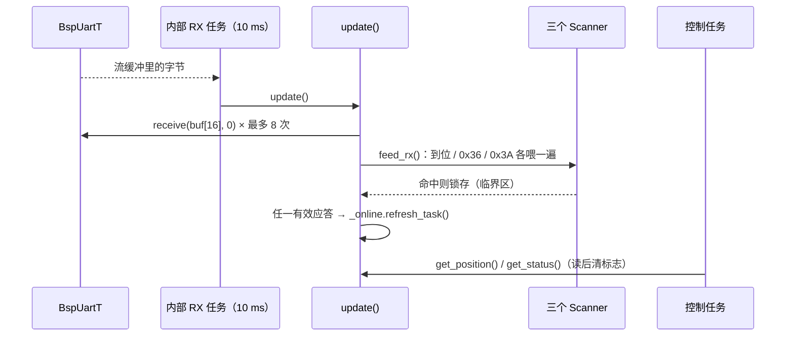

# device_emmv5

> 代码：`device_emmv5.hpp` / `device_emmv5.cpp`　实例：`emm_motor1`（UART7，地址 1）
> 单串口单电机；一路串口挂多台时用 [device_emmv5_group.md](device_emmv5_group.md)。

## 0. 如何快速完整的使用（不需要了解实际实现）

| 步骤 | 文件 | 写什么 |
| --- | --- | --- |
| 1. 头文件 | 使用处 | `#include "device_emmv5.hpp"`；业务侧一般只需 `#include "device_cfg.hpp"` |
| 2. 全局实例 | `device_cfg.cpp` | `DeviceEmmv5T<decltype(bsp_uart7)> emm_motor1({bsp_uart7, 1});` |
| 3. 声明 | `device_cfg.hpp` | `extern DeviceEmmv5T<decltype(bsp_uart7)> emm_motor1;` |
| 4. 显式实例化 | `device_emmv5.cpp` 顶部 | `template class DeviceEmmv5T<BspUartT<uart_detail::DmaTransport, 128, 128>>;` |
| 5. 初始化 | `device_cfg.cpp` 的 `device_init()` | `configASSERT(emm_motor1.init() == Status::OK);` |
| 6. 串口 | `DM_MC02.ioc` + `bsp_cfg.cpp` | UART7 = 921600 8N1；电机菜单 `UartBaud` 必须一致 |
| 7. 业务 | 任务 | 只发命令 + `get_*()`；`update()` 由内部 RX 任务独占 |

```cpp
// device_cfg.cpp
DeviceEmmv5T<decltype(bsp_uart7)> emm_motor1({bsp_uart7, 1});
// device_cfg.hpp
extern DeviceEmmv5T<decltype(bsp_uart7)> emm_motor1;
// device_emmv5.cpp 顶部
template class DeviceEmmv5T<BspUartT<uart_detail::DmaTransport, 128, 128>>;
// device_init()
configASSERT(emm_motor1.init() == Status::OK);   // 创建内部 RX 任务（10 ms，+6）
```

**调用示例**

```cpp
#include "device_cfg.hpp"

(void)emm_motor1.enable(true);
(void)emm_motor1.set_position(emmv5::Direction::CW, 500, 50, 3200, emmv5::PositionMode::Absolute);
(void)emm_motor1.request_position();

int32_t pos = 0;
if (emm_motor1.get_position(pos)) { /* counts，65536/圈 */ }
```

## 职责

1. 调 `emmv5` 协议层生成命令帧；
2. 写进 `BspUartT` 的发送流缓冲；
3. 内部 RX 任务周期读串口，识别三类应答：
   - 到位帧 `addr FD 9F 6B`
   - 位置应答 `addr 36 sign v3 v2 v1 v0 6B`
   - 状态应答 `addr 3A status 6B`
4. 用 `Online` 记录“最近是否收到过有效应答”。

`init()` 创建内部 RX 任务（10 ms，优先级 +6）：只做“读字节 + 喂扫描器”，命中后锁存；
业务层用 `get_position()` / `get_status()` 取走并清标志。Online 阈值 **100 ms**，由 `sys_task` 推进。

## 接收链



- `update()` 非阻塞：每次最多 `8 块 × 16 字节`。
- `get_*()` 在短临界区里一起拷贝值与有效标志。
- `is_online()` 用 `Online`（100 ms）；查询周期应 < 100 ms，否则“没被问”也显示离线。

## 发送链

`enable / set_velocity / set_position / set_quick_* / stop / zero_position / read`：
校验参数 → 协议层拼帧 → `_send()`。

- `_send()` 先检查 `frame.valid()`，再 `uart.send(..., 20 ms)`；超时返回 `TIMEOUT`。
- `read()` 只解析 `CurrentPosition`（0x36）与 `StatusFlag`（0x3A），其它应答丢弃。
- `set_velocity` / `set_position` 校验 `rpm ≤ 5000` 与方向枚举。

## 约束

- 地址 1~255；`0` 是广播地址，用作实例会 `BAD_ARG`。
- 内部 RX 任务是本路串口唯一消费者：业务层**不要**调 `update()`、不要直接读 `BspUart`。
- 对象必须是全局/静态生命周期；不要在 RX 任务里销毁它。
