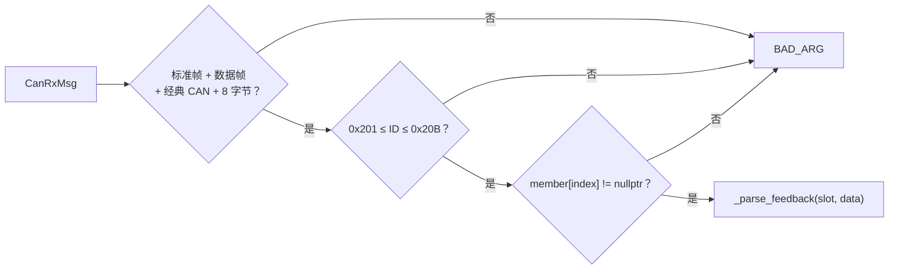

# dji_motor_group

> 代码：`dji_motor_group.hpp` / `dji_motor_group.cpp`　实例：`can3_dji_group`（`device_cfg.cpp`）
> 一条 CAN 总线上的 DJI 电机组：最多 8 台 M3508/M2006 + GM6020 混挂，固定 11 个位置。

## 0. 如何快速完整的使用（不需要了解实际实现）

| 步骤 | 文件 | 写什么 |
| --- | --- | --- |
| 1. 头文件 | 使用处 | `#include "dji_motor_group.hpp"`；业务侧一般只需 `#include "device_cfg.hpp"` |
| 2. 成员常量 | `device_cfg.cpp` | `static const DjiMotorGroupT<decltype(bsp_can3)>::Member gm6020_1{DjiMotorModel::GM6020};` |
| 3. 全局实例 | `device_cfg.cpp` | `DjiMotorGroupT<decltype(bsp_can3)> can3_dji_group({&bsp_can3, …, &m3508_1, …});` |
| 4. 声明 | `device_cfg.hpp` | `extern DjiMotorGroupT<decltype(bsp_can3)> can3_dji_group;` |
| 5. 显式实例化 | `dji_motor_group.cpp` 顶部 | `template class DjiMotorGroupT<BspCanT<16, 16>>;`（总线类型变了才需要改） |
| 6. 初始化 | `device_cfg.cpp` 的 `device_init()` | `configASSERT(can3_dji_group.init() == Status::OK);` |
| 7. 周期调用 | 自己的任务 | 同一任务依次 `update() → set_output() → poll()`（当前在 `App/test/motor/dji_motor_group_test.cpp`） |
| 8. 前置 | `bsp_cfg.cpp` / `bsp_init()` | `bsp_can3` 已实例化并初始化 |

```cpp
// device_cfg.cpp
static const DjiMotorGroupT<decltype(bsp_can3)>::Member gm6020_1 {DjiMotorModel::GM6020}; // 位置 4
static const DjiMotorGroupT<decltype(bsp_can3)>::Member gm6020_6 {DjiMotorModel::GM6020}; // 位置 9
DjiMotorGroupT<decltype(bsp_can3)> can3_dji_group({&bsp_can3,
  nullptr, nullptr, nullptr, nullptr, &gm6020_1, nullptr, nullptr, nullptr, nullptr, &gm6020_6, nullptr});
// device_cfg.hpp
extern DjiMotorGroupT<decltype(bsp_can3)> can3_dji_group;
// dji_motor_group.cpp 顶部
template class DjiMotorGroupT<BspCanT<16, 16>>;
// device_init()
configASSERT(can3_dji_group.init() == Status::OK);
```

**调用示例**

```cpp
#include "device_cfg.hpp"

CanRxMsg rx = {};
for (uint32_t i = 0; i < 8 && bsp_can3.receive(&rx, 0) == Status::OK; ++i)
  (void)can3_dji_group.update(rx);          // 收 + 解

(void)can3_dji_group.set_output(4, 5000);   // 算：只写发送缓冲
(void)can3_dji_group.poll();                // 发：有成员的帧才发

const MotorData &md = can3_dji_group.get_data(4);
```

## 位置模型

反馈标识符连续：C620/C610 = `0x200 + ID`（1~8 → 0x201~0x208），GM6020 = `0x204 + ID`（1~7 → 0x205~0x20B）。
所以 0x201~0x20B 唯一对应 11 个位置，**位置 = 标识符 − 0x201**，接收侧不查表。

| 位置 | 反馈标识符  | 允许型号               | 控制帧                             | 帧内槽位  |
| ---- | ----------- | ---------------------- | ---------------------------------- | --------- |
| 0~3  | 0x201~0x204 | M3508 / M2006          | 0x200                              | 位置      |
| 4~7  | 0x205~0x208 | M3508 / M2006 / GM6020 | 0x1FF（3508/2006）或 0x1FE（6020） | 位置 − 4 |
| 8~10 | 0x209~0x20B | 仅 GM6020              | 0x2FE                              | 位置 − 8 |

**电调 ID ≠ 位置**，装车前按上表在 RoboMaster Assistant 里设 ID：

| 位置 | 型号        | 电调 ID | 控制帧 | 槽位      |
| ---- | ----------- | ------- | ------ | --------- |
| 0~3  | M3508/M2006 | 1~4     | 0x200  | 位置      |
| 4~7  | M3508/M2006 | 5~8     | 0x1FF  | 位置 − 4 |
| 4~7  | GM6020      | 1~4     | 0x1FE  | 位置 − 4 |
| 8~10 | GM6020      | 5~7     | 0x2FE  | 位置 − 8 |

当前台架：位置 4（0x205，GM6020 ID 1，0x1FE 槽 0）与位置 9（0x20A，GM6020 ID 6，0x2FE 槽 1）。
空位必须写 `nullptr` 占位，少写一个后面全部错一位。

## 型号常量

| 型号   | 原始指令上限 | 默认减速比 | 说明                                     |
| ------ | ------------ | ---------- | ---------------------------------------- |
| M3508  | ±16384      | 3591/187   | C620                                     |
| M2006  | ±10000      | 36         | C610                                     |
| GM6020 | ±16384      | 1          | 电流模式，固件 ≥ 1.0.11.2，需打开电流环 |

`Member{model, ratio, offset}`：`ratio` 传 0 用型号默认值；`offset` 是机械零位（rad）。

## `init()`：配置折叠进 Slot

对 11 个位置扫一遍：空位跳过；型号与位置不相容 → `BAD_ARG`；否则把 `limit / offset / ratio / tx_frame / tx_slot` 算进 `Slot`，并置 `_frame_active[frame] = true`。热路径不再看型号。

## `update()`：一帧反馈的解析链



```
DATA[0:2]  ecd = 大端 uint16，0~8191（>= 8192 → 脏帧）
DATA[2:4]  rpm = 大端 int16，**转子转速**
DATA[4:6]  实际转矩电流（不用）
DATA[6]    温度（不用）

velocity  = rpm / ratio × π/30
total_ecd = unwrap_ecd(total_ecd, last_ecd, ecd, 8192)
rotor_ang = total_ecd × 2π / 8192
out_ang   = (rotor_ang − offset) / ratio
angle_multi_round  = out_ang               （double）
angle_single_round = fmod(out_ang, 2π)，负数补一圈 → [0, 2π)
```

跨零展开（半圈 = 4096）：

```
last=8000, now=200  → delta=-7800 < -4096 → +8192 →  392
last=200,  now=8000 → delta=+7800 > +4096 → -8192 → -392
last=1000, now=1100 → delta= 100        → 不变
```

首帧 `total_ecd = ecd`，上电后累计角度从 0 附近起算。解析成功才 `feedback_ready = true` 并
`online.refresh_task()`；`radian_data.acceleration` 恒为 0（跨帧量，留给上层）。

## `set_output()` / `poll()`

- `set_output(index, raw)`：限幅到 `±slot.limit`，大端写进 `_frame_data[tx_frame][tx_slot × 2]`；
  只写缓冲、不发送，反复调用是覆盖。
- `poll()`：依次发 `0x200 / 0x1FF / 0x1FE / 0x2FE`，`_frame_active == false` 的整条跳过；
  单次失败不上报，查 `BspCan::diagnostics`。
- 没写过的槽位一直是 0。

## 线程模型

- 非线程安全：同一任务依次 `update() → set_output() → poll()`，内部无锁。
- `get_data()` 返回 `Slot::data` 的实时引用，读期间不得并发 `update()`；越界/无电机返回静态全零对象。
- 在线判定用 `Slot::online`（30 ms），由 `sys_task` 每 10 ms 推进。
