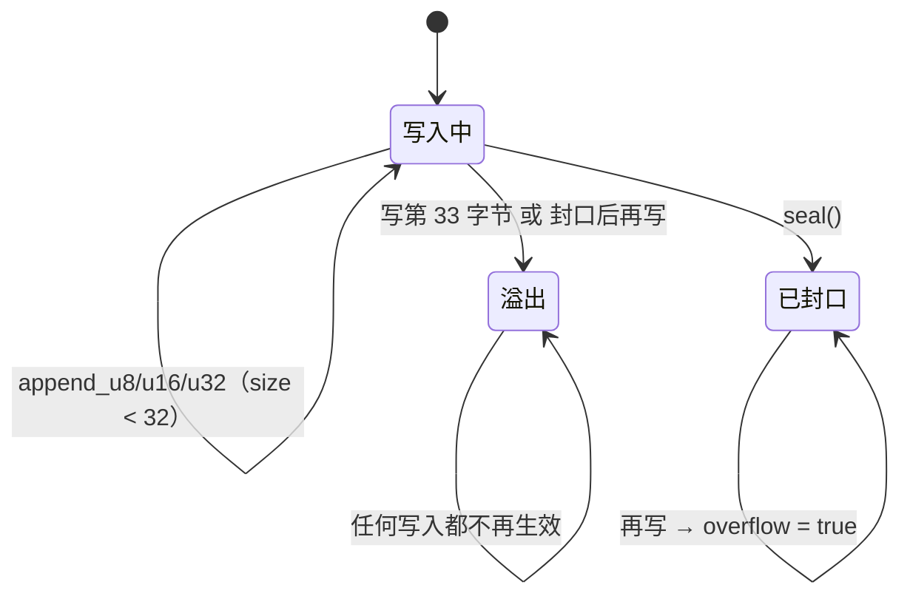

# Protocol 层手册

> 代码：`User/Protocol/emmv5_protocol.{hpp,cpp}`（张大头 EmmV5.0 串口协议）
> 本层只做编码 / 解析，**不碰串口、不创建任务、不持有设备状态**，所以单机驱动与多机驱动能共用同一套帧。

## 1. 定位与边界

| 放这里 | 不放这里 |
| --- | --- |
| 语义参数 → 字节帧（编码） | 发送帧、读串口、开关发送 |
| 字节流 → 应答（解码 / 跨块拼帧） | 地址表、重发、超时、在线判定 |
| 协议常量、功能码查表、工厂函数 | 任何 BSP / Device 头文件 |

分工：**Device 不拼字节，Protocol 不发字节。** 设备层调用工厂函数拿到 `Frame`，再交给 `BspUartT::send()`；
收到的字节交给 `Scanner::feed()`，结果通过引用参数带回。

## 2. 文件与导出面

| 符号 | 作用 |
| --- | --- |
| `emmv5::CHECKSUM = 0x6B` | 每条命令固定校验字节（本工程未实现 XOR / CRC-8） |
| `emmv5::BROADCAST = 0x00` | 广播地址 |
| `emmv5::FRAME_MAX_SIZE = 32` | 单条命令最大字节数（最长约 20） |
| `emmv5::IN_POSITION_MARK1/2/3 = 0xFD / 0x9F / 0x6B` | 到位帧标识 |
| `enum class Direction` | `CW = 0` / `CCW = 1` |
| `enum class PositionMode` | `Relative = 0` / `Absolute = 1` |
| `enum class SystemParam` | `read()` 的参数类型（18 种） |
| `struct Frame` | 值类型帧缓冲，顺序追加 + 封口 + 有效性 |
| `InPositionScanner` / `PositionScanner` / `StatusScanner` | 三类应答的滑动窗口识别器 |
| `build_multi_frame()` | MMCL 多机总帧打包 |
| 8 个命令工厂 | `zero_position` / `enable` / `velocity` / `position` / `quick_position_params` / `quick_position` / `stop` / `read` |

`namespace emmv5` 之外没有任何符号；`.cpp` 里的功能码查表放在匿名 namespace，不导出。

## 3. `Frame`：三态与越界语义

```cpp
struct Frame
{
  uint8_t data[32];
  uint8_t size;
  bool    overflow;  // 写超长或封口后继续写
  bool    sealed;    // 已追加校验字节
};
```

状态机：



- `append_u16` / `append_u32` **一律大端**（协议手册要求多字节字段高字节在前）。
- `seal()` 追加 `0x6B` 并置 `sealed`；已溢出或已封口时保持原状态。
- `valid() == sealed && !overflow && size > 0` —— 设备层发送前必须检查，
  **截断帧绝不发上总线**。
- 非法枚举（如 `read()` 收到未知 `SystemParam`）返回默认构造的空 `Frame`（`size = 0`），
  由设备层转成 `BAD_ARG`。

**编码示例**

```cpp
emmv5::Frame f = emmv5::position(1U, emmv5::Direction::CW, 500U, 50U, 3200, emmv5::PositionMode::Absolute);
if (!f.valid()) { /* BAD_ARG：不发给总线 */ }

// 协议层不发送：交给设备层 / BspUartT
(void)uart.send(f.data, f.size, 20U, nullptr);
```

## 4. 命令帧一览

| 工厂 | 帧布局 | 说明 |
| --- | --- | --- |
| `zero_position(addr)` | `addr 0A 6D 6B` | 清零位置、位置误差、脉冲数 |
| `enable(addr, on)` | `addr F3 AB on 00 6B` | `on` 为 0/1；`sync` 固定 0 |
| `velocity(addr, dir, rpm, accel)` | `addr F6 dir rpmH rpmL accel 00 6B` | 速度模式 |
| `position(addr, dir, rpm, accel, pulses, mode)` | `addr FD dir rpmH rpmL accel p3 p2 p1 p0 mode 00 6B` | 位置模式 |
| `quick_position_params(addr, rpm, accel, mode)` | `addr F1 rpmH rpmL accel mode 00 6B` | 只设参数，不产生运动 |
| `quick_position(addr, pulses)` | `addr FC p3 p2 p1 p0 6B` | 用上一组快速位置参数 |
| `stop(addr)` | `addr FE 98 00 6B` | 紧急刹车，速度/位置模式都可用 |
| `read(addr, param)` | `addr code 6B` | 应答格式随参数不同 |

参数语义：

- **速度**：0~5000 RPM（通讯范围；机械上限看铭牌）。
- **加速度 `accel`**：
  - `0` = 不使用曲线加减速，直接按设定速度运行；
  - `> 0` = 每提升 1 RPM 用时 `(256 − accel) × 50 µs`。
    例：`accel = 50`，0→300 RPM 需要 `300 × 206 × 50 µs = 3.09 s`。
    曲线只影响启停平滑度，不改变匀速段速度。
- **脉冲**：16 细分、1.8° 电机 = 3200 脉冲/圈；32 细分 = 6400。`int32_t` 带符号，
  写入时按 32 位补码转 `uint32_t`。
- **位置模式 `raF`**：`0` = 相对**上一输入目标位置**（不是当前实时位置）；`1` = 绝对。
  部分 Y42 固件支持 `2` = 相对当前实时位置，本工程**不依赖**它（在不支持的固件上会被当成绝对运动，
  表现为第二条命令不动）。
- **`sync` 字节固定写 0**：本工程不使用多机同步启动。

`read()` 的功能码（源码匿名 namespace 里的 `sys_param_code()`）：

| `SystemParam` | code | 应答数值 |
| --- | --- | --- |
| `BusVoltage` | 0x24 | mV |
| `BusCurrent` | 0x26 | mA |
| `PhaseCurrent` | 0x27 | mA |
| `EncoderRaw` | 0x29 | 编码器原始值 |
| `PulseCount` | 0x30 | 实时脉冲数 |
| `EncoderLinear` | 0x31 | 校准后编码器值 0~65535/圈 |
| `InputPulse` | 0x32 | 符号 + 32 位输入脉冲 |
| `TargetPosition` | 0x33 | 符号 + 32 位目标位置，65536/圈 |
| `SetPosition` | 0x34 | 符号 + 32 位实时设定位置 |
| `Velocity` | 0x35 | 符号 + 16 位转速，RPM |
| `CurrentPosition` | 0x36 | 符号 + 32 位实时位置，65536/圈 |
| `PositionError` | 0x37 | 符号 + 32 位位置误差 |
| `BatteryVoltage` | 0x38 | Y42：多圈编码器电池 mV |
| `Temperature` | 0x39 | Y42：温度 ℃ |
| `StatusFlag` | 0x3A | 状态标志位 |
| `OriginFlag` | 0x3B | 回零状态标志位 |
| `StatusAndOriginFlag` | 0x3C | Y42：状态 + 回零标志 |
| `PinStatus` | 0x3D | Y42：引脚状态 |

位置类数值一圈 = 65536，角度 = `value × 360 / 65536`。

## 5. 扫描器：为什么必须跨块拼帧

串口的 `receive()` 是字节流语义，一帧可能被拆成两三块，也可能几帧粘在一块里。
三个扫描器都用「固定长度滑动窗口 + 左移一格」实现跨块装配：

| 扫描器 | 窗口 | 命中条件 | 命中后 |
| --- | --- | --- | --- |
| `InPositionScanner` | 4 字节 | `addr FD 9F 6B` | 清窗，**继续扫完本块** |
| `PositionScanner` | 8 字节 | `addr 36 … 6B`（`window[7] == 0x6B`） | 清窗并 `return true` |
| `StatusScanner` | 4 字节 | `addr 3A status 6B` | 清窗并 `return true` |

- 窗口满了就 `memmove` 左移一格，再放新字节；这样窗口里最多保留「上一次没凑满的后缀」。
- 到位帧是“事件”，同一块里可能有多条，所以继续扫；位置 / 状态是“最新值”，取到就返回。
  **已知行为**：同一块里若粘着同一台电机的两条 0x36，第二条会被丢弃（每台电机每周期只取最新值，
  实际请求都是单条，不影响使用）。
- 地址判断在扫描器内部完成：设备层把同一块字节喂给组内每台电机的扫描器，命中即归属该台。

`PositionScanner` 的数值组合：

```
magnitude = (w[3] << 24) | (w[4] << 16) | (w[5] << 8) | w[6]
value     = (w[2] == 0) ? magnitude : −magnitude     // 用 int64 取负，避开 INT32_MIN 溢出
```

**解析示例**

```cpp
// 每个电机地址一套扫描器，由设备对象持有（不能跨地址共用）
emmv5::PositionScanner   pos_scanner;
emmv5::InPositionScanner inpos_scanner;

int32_t position = 0;
if (pos_scanner.feed(1U, buf, n, position))
{
  // position：counts，65536/圈，带符号
}
if (inpos_scanner.feed(1U, buf, n))
{
  // 本块中至少有一个 addr FD 9F 6B
}
```

## 6. MMCL 多机总帧

```
target(1) + 0xAA(1) + total(2, 大端) + 子命令串(N) + 0x6B(1)
total = N + MULTI_OVERHEAD，MULTI_OVERHEAD = 4 + 1 = 5（含头尾）
子命令 = 各自地址 + 功能码 + 数据 + 0x6B（普通帧原样拼接）
```

`build_multi_frame()` 的约束：

- 长度字段只有 2 字节：`total > 0xFFFF` 或 `total > out_capacity` → 返回 0（非法）。
- `payload` 可能与 `out + 4` 是同一块内存（设备层把子命令直接攒在总帧缓冲里），
  所以内部必须用 `memmove` 而不是逐字节前向拷贝。
- 本工程发送流缓冲区 128 字节 → 子命令上限 123 字节（`128 − 5`），由设备层的
  `MULTI_PAYLOAD_MAX` 提前拦截，`build_multi_frame()` 本身不感知串口容量。

## 7. 与 Device 的接口契约

| 方向 | Protocol 提供 | Device 负责 |
| --- | --- | --- |
| 发 | `Frame`（`valid()` 为真才算完整） | 检查 `valid()`、`uart.send(frame.data, frame.size, 20 ms)` |
| 收 | `Scanner::feed(addr, data, size, out)` | 从流缓冲区取字节、按地址分发、锁存结果、刷 `Online` |

约束：

- 扫描器是有状态的，**每个电机地址一套**，由设备对象持有；不能跨地址共用。
- 扫描器不校验“这条命令是不是我发的”，也不管超时、重发；这些都在设备层。
- 协议层不 include `bsp_uart.hpp`，也不 include 任何 `device_*.hpp`。

## 8. 新增一条协议 / 一个命令

新增命令（同协议）：

1. 在 `emmv5_protocol.hpp` 的对应分区声明 `Frame xxx(...)`，写清参数单位与范围。
2. 在 `.cpp` 按手册的字节顺序 `append_*`，末尾 `seal()`；注释里贴帧布局。
3. 设备层加一个薄接口（`DeviceEmmv5T::xxx` / `DeviceEmmv5GroupT::xxx` / `queue_xxx`），
   多机版必须同时加 `queue_xxx`，否则 MMCL 用不了。
4. 需要应答的，在协议层加扫描器（或扩展 `SystemParam`），设备层补 `get_*()`。

**参数怎么定**

| 参数 | 取值 / 编码 | 校验放哪 |
| --- | --- | --- |
| 地址 | 1~255；0 = 广播 | 设备层 `_send_for()` / 构造时地址表 |
| 方向 | `Direction::CW = 0` / `CCW = 1` | 设备层 `_valid_direction()` |
| 速度 | 0~5000 RPM，2 字节大端 | 设备层 `_valid_rpm()` |
| 加速度 | 0~255；`> 0` 时每 RPM 用时 `(256 − accel) × 50 µs` | 协议层不校验，按手册透传 |
| 脉冲 | `int32_t`，按 32 位补码写入；16 细分 3200/圈 | 设备层不限幅（由使用者决定行程） |
| 位置模式 | `Relative = 0` / `Absolute = 1` | 枚举本身保证；非法值编译期就报 |
| `sync` 字节 | 固定 0（本工程不用多机同步） | 工厂函数里写死 |

- 协议层只负责“拼成手册的字节顺序”，**范围校验放在设备层**：越界值在设备层返回 `BAD_ARG`，
  协议层保持纯编码，方便主机侧单元测试直接比字节。
- 帧长余量：`FRAME_MAX_SIZE = 32`（当前最长 13 字节）。新增字段后先算一遍总长，
  超过 32 就同步改常量；`append_*` 越界会置 `overflow`，`valid()` 变 false，设备层不会发出去。
- 数值编码一律大端；负数按补码写入（`static_cast<uint32_t>(int32_t)`）。

新增一个协议模块（`User/Protocol/<name>_protocol.*`）：

1. 独立 `namespace`，只 include 标准库；不碰串口、不建任务。
2. 编码用「值类型 + 工厂函数」，解析用「独立扫描器结构体」，两者都不持有设备状态。
3. 编解码要能脱离硬件测试：`User/App/test/` 下写一个纯主机可跑的编码用例，
   或在测试任务里用固定字节数组验证切帧。
4. 在设备 `.cpp` 顶部做模板实例化时确认协议头不引入 BSP 依赖。

## 9. 反模式

| 写法 | 后果 |
| --- | --- |
| 在协议层调 `uart.send()` | 单机/多机无法复用，且协议层依赖硬件 |
| 用“一次读到整帧”的假设切帧 | 分块到达时帧被切歪 |
| `Frame` 不检查 `valid()` 就发 | 截断帧发上总线，驱动器行为未定义 |
| 多个电机共用一套扫描器 | 地址判断失效，帧归属错乱 |
| 把 `SystemParam` 的枚举值直接当功能码 | 枚举顺序是代码内顺序，功能码在 `.cpp` 查表里 |
| 用相对模式重发「剩余位移」却按“上一目标”理解 | 相对模式基准是上一输入目标，不是当前位置 |

## 10. 与代码注释的分工

- 代码里保留：每个工厂一行 `@brief`、参数单位 / 范围、单条帧布局。
- 本文覆盖：功能码总表、加速度时间公式与算例、MMCL 布局与容量算术、扫描器行为差异、
  新增命令 / 新协议的步骤。
