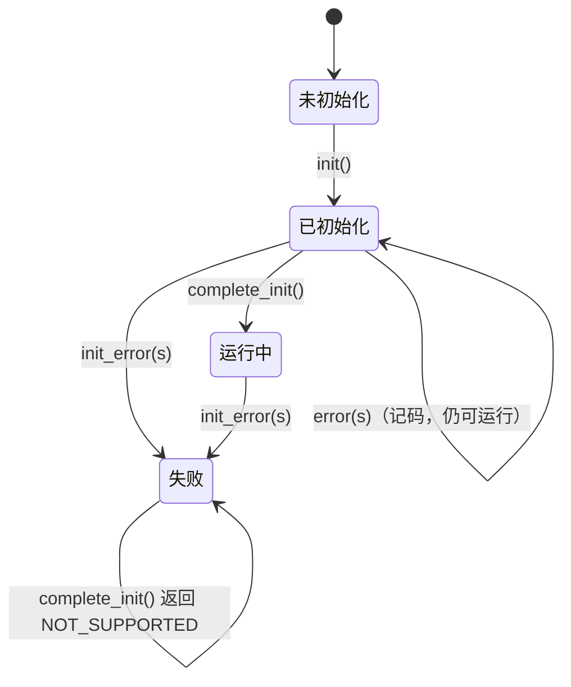
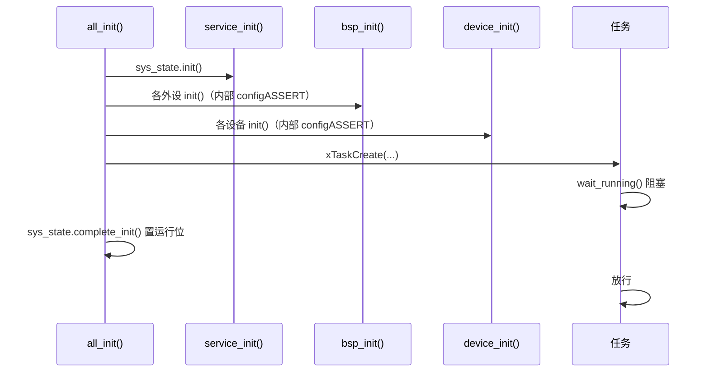

# Service 层手册

> 代码：`User/Service/`　本层不属于 `App → Module → Device → Bsp` 主链，以“工具 / 服务”的形式贯穿各层。
> `EventState` 的完整原理（位分配、状态机、错误传播、已知局限）见
> [系统状态标志原理](../../Docs/guide/系统状态标志原理.md)，本文只写**怎么用、谁该用**。

## 1. 定位与边界

| 文件 | 提供什么 | 谁用 |
| --- | --- | --- |
| `status.hpp/.cpp` | `Status` 枚举 + `EventState` 类 | 全工程返回状态码；`EventState` 只给“维护多个对象的系统” |
| `service_cfg.hpp/.cpp` | 全局实例 `sys_state` + `service_init()` | `api_main.cpp`、任务入口 |
| `online_check.hpp/.cpp` | `Online` 在线检查节点（静态链表） | 有反馈的设备（DJI 电机组、EmmV5） |
| `motor_definition.hpp` | `MotorData` / `LuenbergerMotorData` | 电机类设备与上层控制 |

不能放进来：具体协议解析、外设操作、业务状态机。

## 2. `Status`：全工程统一返回码

```cpp
enum class Status : uint8_t
{
  OK = 0, BUSY, TIMEOUT, FULL, IO_ERROR, BAD_ARG, NOT_INIT, NOT_SUPPORTED,
};
```

| 值 | 语义 | 典型来源 |
| --- | --- | --- |
| `OK` | 成功 | 通用 |
| `BUSY` | 资源被占用 / 总线不可用 | `BspCan::send()` 在 Bus-Off 或恢复期；重复注册 |
| `TIMEOUT` | 等待超时 | `receive()` 无数据；`send()` 只入队一部分 |
| `FULL` | 缓冲 / 链表 / 堆满 | MessageBuffer 满、任务创建失败、地址表超上限 |
| `IO_ERROR` | 硬件 / 传输错误 | 流缓冲区创建失败、HAL 启动失败 |
| `BAD_ARG` | 参数非法 | 空指针、地址 0、越界、型号放错位置 |
| `NOT_INIT` | 未初始化 | 所有 `init()` 之前的调用 |
| `NOT_SUPPORTED` | 当前阶段不允许 | `complete_init()` 发现已有初始化失败记录 |

**枚举值 = 事件组位号**，所以顺序是硬契约，不能重排。

使用约定：

- 运行期可恢复的失败（噪声帧、总线忙、超时、缓冲满、外部输入越界）→ `return Status`。
- 初始化失败、配置与实物不符、自己算出的下标越界 → `configASSERT`。断言写在该对象自己的 `init()` 里，
  外层不再重复验。

## 3. `EventState`：一个实例 = 一个事件组

### 3.1 位分配（每个实例各 24 位）

| 位 | 名称 | 谁能置 | 谁能清 |
| --- | --- | --- | --- |
| 0 | `Status::OK` 位 | `init()` | `error()` / `init_error()` |
| 1~21 | 状态码位（位号 = 枚举值） | `error()` / `init_error()` | 不清（粘滞） |
| 22 | `RUNNING_BIT` | `complete_init()` | `init_error()` |
| 23 | `INIT_FAIL_BIT` | `init_error()` | 不清（粘滞） |

bit 24~31 是 FreeRTOS 事件组的控制字节，不可用。`static_assert(NOT_SUPPORTED < STATUS_MAX = 22)`
保证以后新增状态码撞上 bit 22 时**编译期就报错**。

### 3.2 八个接口

| 接口 | 作用 |
| --- | --- |
| `init()` | 创建事件组并置 OK 位；幂等；失败返回 `FULL` |
| `complete_init()` | 置运行位；已有 `INIT_FAIL` 时返回 `NOT_SUPPORTED` 且不置位 |
| `error(s)` | 记错误码 + 清 OK 位，**不动运行位** → 运行期错误 |
| `init_error(s)` | 置 `INIT_FAIL` + 清运行位 + 记错误码 → 初始化错误 |
| `is_ready()` | 事件组是否已创建 |
| `running()` | 运行位是否置位 |
| `error_code()` | 返回已记录的**最小**错误码；无错返回 `OK`；未 init 返回 `NOT_INIT` |
| `wait_running()` | 阻塞等「运行位 **或** 失败位」；未 init 或等到失败 → `vTaskDelete(NULL)` |

不变式：`INIT_FAIL_BIT` 置位 ⟹ 运行位已清、`error_code() != OK`。

### 3.3 典型生命周期



```cpp
// all_init()
service_init();                 // sys_state.init()
bsp_init();
device_init();
xTaskCreate(...);               // 任务入口第一句 wait_running()
configASSERT(sys_state.complete_init() == Status::OK);

// 任务入口
extern "C" void some_task(void *)
{
  sys_state.wait_running();     // 初始化失败会自删，不会返回
  for (;;) { ... }
}
```

**为什么 `wait_running()` 同时等两位**：只等运行位的话，初始化失败时它永不置位，任务会永久阻塞。

### 3.4 谁该用、谁不该用

| 角色 | 该不该持有 | 理由 |
| --- | --- | --- |
| 整个 MCU（`sys_state`） | ✅ | 需要回答“系统到什么阶段了、有没有出过错” |
| 一条 CAN 总线 / 一路串口 | ✅（按需新建实例） | 局部故障不应污染系统级阶段判断 |
| 单个设备（一个电机、一个 IMU） | ❌ | 只对自己负责，失败 `return Status` 给调用方（`device_init()`） |

反例的后果：一条总线上一个节点失败 → 全局 `INIT_FAIL` → `complete_init()` 不置运行位 →
所有任务卡在 `wait_running()`，本来能跑的总线也被拖停。

## 4. `Online`：静态链表 + tick 差值

### 4.1 结构

- 每个 `Online` 对象在**构造时**挂到内部单向链表（`_head` / `_tail`），析构时摘除。
- 因此对象**不可复制 / 移动**，且必须是全局或设备对象的成员（生命周期稳定）。
- 构造时 `_last_refresh_tick = now − timeout`，初始状态 `TIMEOUT` —— 收到第一帧有效数据才算在线。

### 4.2 三件套

```cpp
class Foo
{
  Online _online{100};                       // 1) 成员：阈值 100 ms（默认 30）
};

// 2) 收到有效数据时续命（任务上下文）
_online.refresh_task();
// 或（中断上下文）
_online.refresh_isr();

// 3) 周期推进（只能在一个任务里做，本工程是 sys_task，10 ms）
Online::update();
```

- `refresh_task()` / `refresh_isr()` 只写 `_last_refresh_tick` 与 `Status::OK`；
  临界区实现：任务侧 `taskENTER_CRITICAL()`，中断侧 `taskENTER_CRITICAL_FROM_ISR()`。
- `update()` 遍历链表，`now − last_refresh ≥ pdMS_TO_TICKS(timeout_gap)` → `TIMEOUT`，否则 `OK`。
  tick 差值用无符号减法，回绕安全。
- `is_online()` 返回最近一次 `update()` 算出的 `Status`（`OK` = 在线，`TIMEOUT` = 离线）。

### 4.3 时间语义

- `timeout_gap` 单位是**毫秒**，与 `update()` 的调用周期无关。
- 调用周期只决定**判定延迟上限**：10 ms 调用一次，最坏晚 10 ms 判出离线。
- 调用周期应不大于最小的 `timeout_gap`。
- 依赖 `configTICK_RATE_HZ == 1000`（tick = 1 ms）。

### 4.4 调度器启动前构造

`Online` 的链表操作包在 `ScopedTaskCritical` 里：调度器尚未启动时它不进入临界区
（`xTaskGetSchedulerState() == taskSCHEDULER_NOT_STARTED`）。所以 `device_cfg.cpp` 里的
全局设备对象可以在 `main()` 之前静态构造。

### 4.5 与 `EventState` 的分工

`Online` 只回答“最近有没有收到数据”，不登记错误、不参与阶段判断。需要系统级错误时，
由持有者把 `Status` 往上抛，**不要**让 `Online` 自己去写 `EventState`。

## 5. `motor_definition.hpp`：通用运动学数据

```cpp
struct MotorData
{
  struct Radian {
    float  angle_single_round;  // 单圈机械角 (rad)
    double angle_multi_round;   // 累计多圈机械角 (rad)
    float  velocity;            // 角速度 (rad/s)
    float  acceleration;        // 角加速度 (rad/s^2)
  } radian_data;

  struct Param {
    float offset;  // 设备轴机械零位 (rad)
    float ratio;   // 设备轴转速 / 输出轴转速，必须 > 0
  } param;
};
```

- 约定：`radian_data` 一律表示**最终机构输出轴**；各设备先把协议原始值换算到设备轴，
  再按 `(设备轴角度 − offset) / ratio` 换算到输出轴。
- 本文件只存数据，不含协议、不含硬件、不含函数。**结构已定稿，不要改**。
- `LuenbergerMotorData` 是可选的观测器输出，目前无引用。
- 角加速度是**跨帧量**：`DjiMotorGroupT` 不填（恒 0），需要时由上层自己差分 + 滤波。

## 6. 初始化顺序与任务闸门



顺序不能换：

1. `service_init()` 必须最先：后面各层失败要靠它上报（虽然设备层不写它，但 `all_init()` 需要它先就绪）。
2. `bsp_init()` 在 `device_init()` 之前：设备只持有 BSP 实例的引用。
3. 任务创建在两层 init 之后、`complete_init()` 之前：任务入口自己会在门口等。

## 7. 新增一个 Service 模块

1. 只依赖 `status.hpp` 与 FreeRTOS，**不 include 任何 Bsp / Device 头文件**。
2. 需要全局实例就在 `service_cfg.{hpp,cpp}` 里 `extern` + 定义；需要初始化就把动作收进
   `service_init()`（内部 `configASSERT`）。
3. 若需要周期推进（如 `Online::update()`），由 `sys_task` 调用，并在本文与 `sys_task` 注释里写清周期。
4. 线程安全按「单写者 / 短临界区 / 不阻塞」三选一，不要引入与本层无关的互斥量。

**参数怎么定**

| 模块 | 参数 | 位置 | 取值 / 约束 |
| --- | --- | --- | --- |
| `EventState` | 实例数量 | `service_cfg.hpp` / 使用处 | 一个实例 = 一个事件组（24 位）；按子系统建，不要给单个设备建 |
| `Online` | `timeout_gap` | 设备对象成员构造，如 `Online _online{100}` | 单位毫秒；默认 30；应 ≥ `sys_task` 周期（10 ms），且 ≥ 设备应答周期 |
| `Online` | 推进周期 | `sys_task.cpp` 的 `SYS_TASK_PERIOD_MS` | 10 ms；只决定判定延迟上限，不影响阈值本身 |
| `Service` 初始化 | `service_init()` | `service_cfg.cpp` | 无参数；内部 `configASSERT`，失败就地停机 |

## 8. 反模式

| 写法 | 后果 |
| --- | --- |
| 设备里调用 `sys_state.init_error()` | 单点故障拖停整机 |
| 在 ISR 里调 `Online::update()` | 遍历链表可能阻塞其他中断，且语义上不需要 |
| `Online` 对象放进局部变量 / 复制设备对象 | 链表节点地址失效 |
| 用 `wait_running()` 在 ISR 里等 | 会阻塞调度，禁止 |
| 把 `Status` 枚举当普通数字比较大小 | 它是位号，不是等级 |
| 重排 `Status` 枚举 | 改变事件组语义，破坏所有已置位记录 |

## 9. 与代码注释的分工

- 代码里保留：每个接口的单位 / 返回值 / 前置条件、位分配（因为 `static_assert` 就在旁边）。
- 本文覆盖：谁该用、生命周期时序、`Online` 的调用三件套与时间语义、
  `MotorData` 的换算约定、新增模块清单。
- 更深的推演（为什么用事件组、状态机、错误传播链、已知局限）在
  [系统状态标志原理](../../Docs/guide/系统状态标志原理.md)，不在代码里重复。
