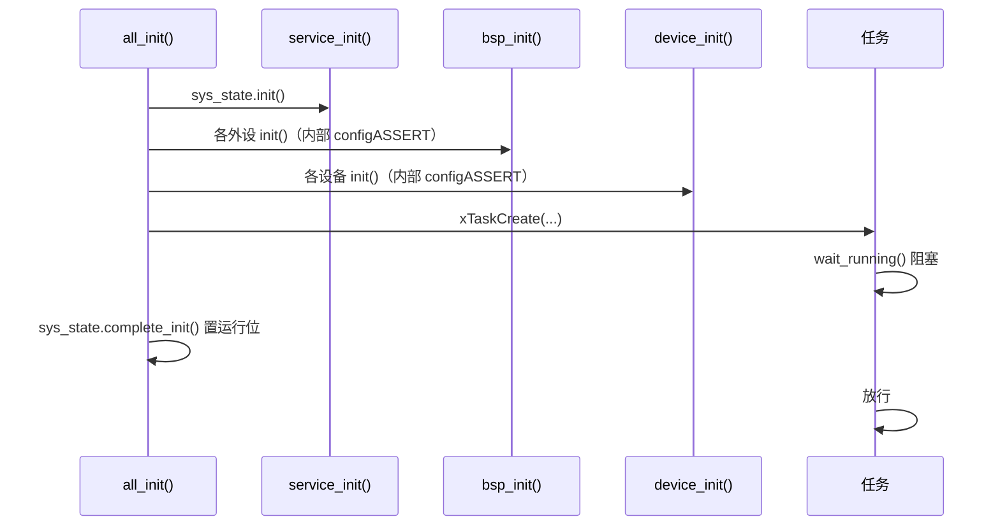

# service_cfg

> 代码：`service_cfg.hpp` / `service_cfg.cpp`

Service 层统一入口与全局实例。

## 内容

- `extern EventState sys_state;`：整个 MCU 的状态（见 [status.md](status.md)）。
- `service_init()`：`configASSERT(sys_state.init() == Status::OK);`

## 初始化顺序与任务闸门

顺序不能换：

1. `service_init()` 最先：`all_init()` 依赖事件组就绪。
2. `bsp_init()` 在 `device_init()` 之前：设备只持有 BSP 实例的引用。
3. 任务创建在两层 init 之后、`complete_init()` 之前：任务入口自己会在门口等。

## 新增一个 Service 模块

1. 只依赖 `status.hpp` 与 FreeRTOS，不 include 任何 Bsp / Device 头文件。
2. 需要全局实例就在本文件的 `.hpp` `extern` + `.cpp` 定义；初始化动作收进 `service_init()`（内部断言）。
3. 需要周期推进（如 `Online::update()`）就由 `sys_task` 调用，并写清周期。
4. 线程安全按「单写者 / 短临界区 / 不阻塞」三选一。

## 参数

| 模块 | 参数 | 位置 | 取值 / 约束 |
| --- | --- | --- | --- |
| `EventState` | 实例数量 | `service_cfg.hpp` / 使用处 | 一个实例 = 一个事件组；按子系统建，不给单个设备建 |
| `Online` | `timeout_gap` | 设备对象成员构造，如 `Online _online{100}` | 毫秒；默认 30；应 ≥ `sys_task` 周期（10 ms）与设备应答周期 |
| `Online` | 推进周期 | `sys_task.cpp` 的 `SYS_TASK_PERIOD_MS` | 10 ms；只决定判定延迟上限 |
| `service_init()` | — | `service_cfg.cpp` | 无参数；内部断言，失败停机 |

## 反模式

| 写法 | 后果 |
| --- | --- |
| 设备里调用 `sys_state.init_error()` | 单点故障拖停整机 |
| 在 ISR 里调 `Online::update()` | 遍历链表可能阻塞其他中断 |
| `Online` 放局部变量 / 复制设备对象 | 链表节点地址失效 |
| 在 ISR 里 `wait_running()` | 阻塞调度 |
| 重排 `Status` 枚举 | 改变事件组语义 |
