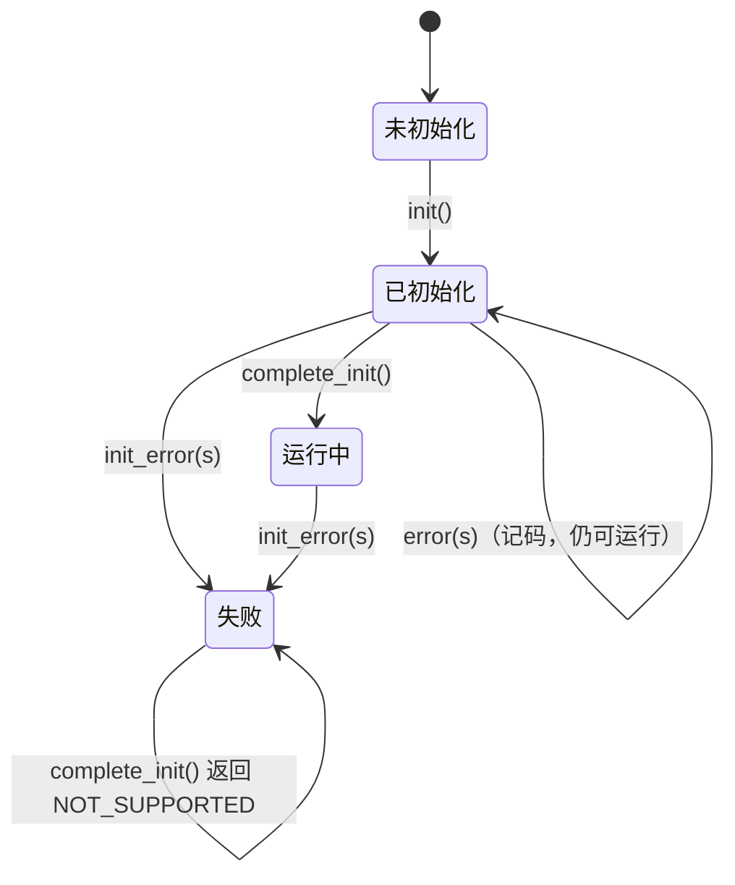

# status

> 代码：`status.hpp` / `status.cpp`　实例：`sys_state`（`service_cfg.cpp`）

## `Status`

```cpp
enum class Status : uint8_t
{
  OK = 0, BUSY, TIMEOUT, FULL, IO_ERROR, BAD_ARG, NOT_INIT, NOT_SUPPORTED,
};
```

| 值 | 语义 | 典型来源 |
| --- | --- | --- |
| `OK` | 成功 | 通用 |
| `BUSY` | 资源被占用 / 总线不可用 | Bus-Off 或恢复期、重复注册 |
| `TIMEOUT` | 等待超时 | `receive()` 无数据；`send()` 只入队一部分 |
| `FULL` | 缓冲 / 链表 / 堆满 | MessageBuffer 满、任务创建失败、地址表超上限 |
| `IO_ERROR` | 硬件 / 传输错误 | 流缓冲创建失败、HAL 启动失败 |
| `BAD_ARG` | 参数非法 | 空指针、地址 0、越界、型号放错位置 |
| `NOT_INIT` | 未初始化 | 所有 `init()` 之前的调用 |
| `NOT_SUPPORTED` | 当前阶段不允许 | `complete_init()` 发现已有失败记录 |

**枚举值 = 事件组位号，顺序是硬契约，不能重排。**

使用约定：

- 运行期可恢复的失败（噪声帧、总线忙、超时、缓冲满、外部输入越界）→ `return Status`。
- 初始化失败、配置与实物不符、自己算出的下标越界 → `configASSERT`，断言写在该对象自己的 `init()` 里。

## `EventState`

一个实例 = 一个事件组 = 一份「阶段 + 错误登记」。

### 位分配（每个实例 24 位）

| 位 | 名称 | 谁能置 | 谁能清 |
| --- | --- | --- | --- |
| 0 | `Status::OK` 位 | `init()` | `error()` / `init_error()` |
| 1~21 | 状态码位（位号 = 枚举值） | `error()` / `init_error()` | 不清（粘滞） |
| 22 | `RUNNING_BIT` | `complete_init()` | `init_error()` |
| 23 | `INIT_FAIL_BIT` | `init_error()` | 不清（粘滞） |

bit 24~31 是 FreeRTOS 事件组控制字节。`static_assert(NOT_SUPPORTED < STATUS_MAX = 22)` 保证状态码
不会撞上 bit 22。

### 八个接口

| 接口 | 作用 |
| --- | --- |
| `init()` | 建事件组并置 OK 位；幂等；失败返回 `FULL` |
| `complete_init()` | 置运行位；已有 `INIT_FAIL` 时返回 `NOT_SUPPORTED` 且不置位 |
| `error(s)` | 记错误码 + 清 OK 位，不动运行位（运行期错误） |
| `init_error(s)` | 置 `INIT_FAIL` + 清运行位 + 记码（初始化错误） |
| `is_ready()` | 事件组是否已创建 |
| `running()` | 运行位是否置位 |
| `error_code()` | 已记录的**最小**错误码；无错返回 `OK`；未 init 返回 `NOT_INIT` |
| `wait_running()` | 阻塞等「运行位 **或** 失败位」；未 init 或等到失败 → `vTaskDelete(NULL)` |

不变式：`INIT_FAIL_BIT` 置位 ⟹ 运行位已清、`error_code() != OK`。

### 生命周期



```cpp
// all_init()
service_init();                 // sys_state.init()
bsp_init();
device_init();
xTaskCreate(...);               // 任务入口第一句 wait_running()
configASSERT(sys_state.complete_init() == Status::OK);

// 任务入口
extern "C" void some_task(void *)
{
  sys_state.wait_running();     // 初始化失败会自删，不返回
  for (;;) { ... }
}
```

`wait_running()` 同时等两位：只等运行位的话，初始化失败时任务会永久阻塞。

### 谁该用

| 角色 | 该不该持有 | 理由 |
| --- | --- | --- |
| 整个 MCU（`sys_state`） | ✅ | 需要回答“系统到什么阶段、有没有出过错” |
| 一条 CAN 总线 / 一路串口 | ✅（按需建实例） | 局部故障不污染系统级判断 |
| 单个设备 | ❌ | 失败 `return Status` 给调用方（`device_init()`） |

反例：一条总线一个节点失败 → 全局 `INIT_FAIL` → 所有任务卡在 `wait_running()`。

更深的原理见 [系统状态标志原理](../../Docs/guide/系统状态标志原理.md)。
